# Auto-Ontology 설치하기 (처음부터)

> 이 문서는 **두 부분**입니다.
> 1. **위쪽 (이 부분)**: 설치 방법. 아무것도 없는 상태에서 Chat 질문까지 가는 순서입니다.
> 2. **아래쪽**: [Auto-Ontology, 궁금한 것부터 풀어 보기](#auto-ontology-궁금한-것부터-풀어-보기). 무엇을 하는 도구이고 어떻게 동작하는지를 질문 순서대로 풀었습니다.
>
> 이 저장소는 [NVIDIA/auto-ontology](https://github.com/NVIDIA/auto-ontology) 위에 **한국어 설치 가이드와 샘플 실행 구성**을 얹은 **비공식** 저장소입니다(Apache-2.0, 원본 `LICENSE` 그대로). 공식 설명서는 [`README.md`](./README.md)이고, 이 문서는 그것을 대체하지 않습니다.
>
> 표시 안내: ✅ 이 문서를 쓴 환경(Windows + Wide World Importers 샘플)에서 **직접 실행해 확인**한 것, ⏳ 아직 확인하지 못한 것입니다.

**Windows 10/11**에서 아무것도 없는 상태로 시작해 Chat 질문까지 가는 순서입니다. 명령은 **Git Bash** 기준입니다.

**한 줄 요약**: NVIDIA 계정으로 API 키 받기 → 저장소 받기 → **`NVIDIA_API_KEY=nvapi-… bash scripts/setup.sh`** → **`docker compose … up` 한 줄** → 로그인 → 질문.

> **직접 준비하는 것은 NVIDIA 계정과 API 키뿐입니다.** DB 비밀번호와 로그인 비밀번호는 **내부 테스트용 고정값**이고, `.env` 수정과 코드 패치, 줄바꿈 변환은 스크립트가 합니다. 이 구성은 **내 컴퓨터(localhost)에서 샘플 DB로 써 보는 용도**입니다. 운영 환경에는 쓰지 마세요.

## 준비물
| 필요한 것 | 설명 |
|---|---|
| **Docker Desktop** | 설치 후 **실행해 두기**. 고래 아이콘이 "running"이 될 때까지 기다립니다. 꺼져 있으면 `failed to connect to the docker API`가 납니다 |
| **Git** | Git Bash가 같이 설치됩니다 |
| **NVIDIA 계정** | **가입이 필요합니다.** 계정이 없으면 https://build.nvidia.com 에서 가입(Sign Up)합니다. 가입 절차의 세부(인증 방식, 무료 사용량 한도)는 직접 확인하지 못했습니다 ⏳ |
| **NVIDIA API 키** | 위 계정으로 로그인한 뒤 https://build.nvidia.com 에서 **Get API Key**. `nvapi-…`로 시작합니다. **OpenAI 키로는 동작하지 않습니다**(스크립트가 거절합니다) |

시간: 첫 이미지 빌드는 수 분에서 십수 분, 구축은 샘플 기준 용어 생성에 약 15분과 관계 단계입니다(어림값).

## 1단계. 받기
```bash
git clone https://github.com/CcGKIM/auto-ontology-ko.git
cd auto-ontology-ko
```
Windows 줄바꿈(CRLF)은 신경 쓰지 않아도 됩니다. 저장소의 `.gitattributes`가 컨테이너용 파일을 LF로 받게 하고, 2단계 스크립트가 한 번 더 확인합니다.

이 저장소에는 원본에 없는 `docker-compose.sample.yml`, `sample-data/`, `scripts/`, `patches/`, `README.ko.md`가 추가되어 있습니다. NVIDIA 원본만 받으면 2단계 스크립트가 없어 아래 순서가 동작하지 않습니다.

## 2단계. 설정 — NVIDIA 키만 넣어 실행 ✅
```bash
NVIDIA_API_KEY=nvapi-여기에-내-키 bash scripts/setup.sh
```
`nvapi-여기에-내-키` 자리에 본인의 NVIDIA API 키를 넣고 한 줄로 실행합니다. 이 한 줄이 설정의 전부입니다.

- 키는 `.env`에만 저장되고 화면에는 출력되지 않습니다.
- 명령줄에 쓴 키는 터미널의 명령 기록(history)에 남습니다. 공용 PC라면 실행 후 기록을 지우세요.
- 키 없이 `bash scripts/setup.sh`만 실행하면 키를 물어봅니다(입력은 화면에 보이지 않음).

| 스크립트가 하는 일 | 내용 |
|---|---|
| ① 줄바꿈 | 컨테이너에서 도는 파일 5개의 CRLF를 LF로 바꿉니다(안 바꾸면 마이그레이션이 `exit 127`) |
| ② 코드 패치 | `patches/nvidia-hosted-llm.patch`를 적용합니다(호스팅 NVIDIA 모델이 받는 요청 방식으로 바꿈, 아래 "참고") |
| ③ `.env` 생성 | `.env.example`에서 만들고, **내 키**와 아래 **고정 테스트값**, 샘플 DB 연결, 동작하는 임베딩 모델을 채웁니다 |

**고정 테스트값** (공개된 값이므로 다른 곳에 쓰지 마세요)

| 항목 | 값 |
|---|---|
| 웹 로그인 | `admin@nvidia.com` / `autoontologypassword123` |
| Postgres, pgAdmin 비밀번호 | `autoontology-test` |

- **같은 컴퓨터에서만 접속됩니다.** `docker-compose.sample.yml`이 열리는 모든 포트(3000, 3001, 3002, 5050, 5432)를 `127.0.0.1`에만 묶습니다. 다른 PC에서는 접속할 수 없습니다.
- 여러 번 실행해도 안전합니다. `.env`가 이미 있으면 **건드리지 않습니다**(새로 만들려면 `--force`).
- 옵션: `--auto-compile`(구축 자동 시작, 3단계 참고), `--random-secrets`(고정값 대신 무작위 비밀번호), `--skip-patch`.
- 키가 `nvapi-`로 시작하지 않으면 `.env`를 만들지 않고 멈춥니다.

**검증** 줄바꿈이 CRLF인 새 클론에서 스크립트를 실행해 확인했습니다 ✅: 5개 파일이 LF로 바뀌고, 패치가 적용되어 파이썬 컴파일이 되며, `.env`에 키와 테스트값이 들어가고, 두 번째 실행은 아무것도 바꾸지 않고, OpenAI 키(`sk-…`)는 거절됩니다. 반면 **고정 비밀번호와 `127.0.0.1` 묶음으로 전체 스택을 처음부터 올려 본 것은 아직 아닙니다** ⏳(`docker compose config`로 포트가 `127.0.0.1`로 합쳐지는 것만 확인).

## 3단계. 한 줄로 전부 띄우기 (샘플 데이터 포함) ✅

```bash
docker compose -f docker-compose.yml -f docker-compose.sample.yml up -d --build
```

`-f`를 매번 쓰기 번거로우면 `.env` 맨 아래에 두 줄을 넣으세요(선택). 그러면 `docker compose up -d --build`만으로 같아집니다. 두 줄이 있을 때는 `sample-data`가 포함되고 없을 때는 빠지는 것을 `docker compose config`로 확인했습니다(실제 `.env`가 아니라 임시 폴더의 더미 `.env`로 확인).
```
COMPOSE_PATH_SEPARATOR=|
COMPOSE_FILE=docker-compose.yml|docker-compose.sample.yml
```

**이 한 줄이 순서대로 하는 일**

| 순서 | 서비스 | 하는 일 |
|---|---|---|
| 1 | `postgres` | 데이터베이스 시작 (`healthy`가 될 때까지 대기) |
| 2 | `*-migrate` | 앱이 쓸 DB 구조 만들기. 끝나면 `Exited (0)` |
| 3 | **`sample-data`** | **샘플 DB(Wide World Importers)를 적재.** 이미 있으면 건너뛰고, 중간에 멈춘 상태면 다시 적재합니다. 끝나면 **샘플 질문**을 로그에 출력하고 `Exited (0)` |
| 4 | `ingestion-service` | **`sample-data`가 성공해야 시작합니다.** DB 구조를 읽어 카탈로그와 임베딩을 만듦 |
| 5 | `auto-ontology`, `frontend` | 백엔드와 웹 화면 |

**확인**
```bash
docker compose ps                    # sample-data 와 *-migrate 는 Exited (0), 나머지는 healthy
docker compose logs sample-data      # 샘플 질문 4개와 기대하는 답
docker compose logs ingestion-service | grep "Data ingestion finished"
```
마지막 줄에 `Data ingestion finished successfully … 51 table(s), 589 column(s)`가 나오면 DB 구조 읽기가 끝난 것입니다. 이 줄이 안 나오고 임베딩이 `500`으로 반복되면 `.env`의 `EMBED_MODEL`을, 마이그레이션 컨테이너가 `exit 127`이면 줄바꿈을 확인하세요(아래 "막혔을 때").

**구축까지 자동으로 하려면 (선택)** ✅

구축(Semantic Compilation)은 **기본이 꺼짐**입니다. 코드에 "한 번도 켠 적 없는 인스턴스는 스스로 컴파일을 시작하지 않는다"고 적힌 **옵트인** 설계이고, 환경변수로 기본값을 바꾸는 설정은 없습니다. 구축은 AI를 수십 번 호출해서 **비용이 나가기 때문**으로 보입니다. 그래서 한 줄을 실행해도 처음에는 `Enable Semantic Compilation`이 꺼진 채로 뜨고, 4단계에서 직접 켭니다.

한 줄 실행만으로 구축까지 이어지게 하려면 2단계를 `NVIDIA_API_KEY=nvapi-… bash scripts/setup.sh --auto-compile`로 실행하거나, `.env`에 이 한 줄을 직접 넣으세요.
```
SAMPLE_AUTO_COMPILE=true
```

| | 옵션 없음 (기본) | `SAMPLE_AUTO_COMPILE=true` |
|---|---|---|
| 설정 행 (`frontend.configurations`) | 생기지 않음 | `semantic_compilation_enabled = true`가 들어감 |
| 인제스천 로그 | `compilation disabled; scheduler idle` | `compilation enabled; scheduler started` |
| 구축 | 4단계에서 직접 켤 때까지 시작 안 함 | **한 줄 실행 직후 자동 시작** (약 22분) |

- **이미 정해 둔 선택은 덮어쓰지 않습니다.** 설정에 값이 있으면(사용자가 `false`로 꺼 둔 경우 포함) 그대로 둡니다.
- 설정 테이블은 프런트엔드 마이그레이션이 만들기 때문에, `sample-data`가 그 완료를 기다린 뒤 값을 넣고, `ingestion-service`는 그 뒤에 시작합니다(인제스천은 시작할 때 이 값을 읽습니다).
- 값을 넣지 못해도 스택을 멈추지 않고 경고만 출력합니다(`sample-data` 로그에서 확인).
- **비용 주의**: 이 옵션을 켜면 **명시적인 클릭 없이** NVIDIA API 호출이 나갑니다. 키가 맞는지 먼저 확인한 뒤에 쓰세요.

**알아 둘 점**
- 첫 빌드는 **인터넷이 필요합니다.** `sample-data` 이미지(약 714MB)가 GitHub의 `auto-ontology-eval`에서 **고정한 커밋(`ec41b2c`)** 의 샘플 데이터(약 240MB)만 받아 담습니다.
- 자기 DB에 연결해서 쓰려면 `-f docker-compose.sample.yml`을 빼면 됩니다. 기존 `docker-compose.yml`은 **수정하지 않았습니다.**
- Windows 줄바꿈이 섞여도 `sample-data`는 이미지를 만들 때 스크립트의 `\r`을 제거하고, 데이터를 읽을 때 UTF-8을 강제해서 앞에서 겪은 두 오류(`exit 127`, cp949 CSV 실패)에 영향을 받지 않습니다.
- 이 파일들(`docker-compose.sample.yml`, `sample-data/`)은 NVIDIA 원본에 **없고**, 이 저장소에서 추가한 것입니다.

**검증 범위** ⏳
- `sample-data` 이미지는 **임시 Postgres**에서 시험했습니다. 빈 DB 적재(인보이스 줄 228,265개, FK 98개 확인), 다시 실행하면 0초에 건너뜀, FK를 모두 지운 중간 상태에서 재시도해 98개로 복구, 질문 샘플 출력까지 모두 확인했습니다.
- 합친 설정도 `docker compose config`로 검증했고, `ingestion-service`가 `sample-data`의 성공을 기다리는 것도 확인했습니다.
- **자동 구축 옵션도 처음부터 확인했습니다** ✅. 볼륨을 모두 지우고 `SAMPLE_AUTO_COMPILE=true`로 한 줄을 실행했더니 설정 행이 들어갔고, 인제스천이 `compilation enabled; scheduler started`를 찍었으며, 클릭 없이 구축이 `running: true`로 시작되어 51개 테이블 처리에 들어갔습니다(26초). 옵션 없이 올렸을 때는 설정 행이 **0개**이고 `compilation disabled`로 예전과 같았습니다.
- 예외 경로는 **임시 Postgres**에서 시험했습니다. 설정 테이블이 없으면 기다린 뒤 경고하고 실패 코드로 끝나며, 행이 없으면 넣고, **이미 `false`로 저장돼 있으면 덮어쓰지 않았습니다.**
- **전체 스택을 처음부터 이 한 줄로 올려 확인했습니다** ✅. 이 프로젝트의 컨테이너와 볼륨을 `docker compose down -v`로 모두 지운 뒤 위의 한 줄을 그대로 실행한 결과입니다.

| 확인 | 결과 |
|---|---|
| 소요 시간 | **26초** (Docker 빌드 캐시가 있는 상태) |
| 순서 | `sample-data`가 `Exited (0)` 한 **뒤에** `ingestion-service`가 시작 |
| 샘플 데이터 | 2,259,097행 적재, 샘플 질문 4개 출력 |
| 인제스천 | `51 table(s), 589 column(s), 640 embedding row(s)` (지우기 전과 같은 수치) |
| 서비스 | `auto-ontology`, `-frontend`, `-ingestion-service`, `postgres` 모두 `healthy` |
| 로그인 | 새 DB에서 관리자 로그인 성공. `Enable Semantic Compilation`은 **꺼짐**, `Distinct Value Scanning`은 **켜짐**이 기본 |

- **26초는 캐시가 있을 때의 값**입니다. 이미지 캐시가 전혀 없는 PC에서는 파이썬 의존성과 프론트엔드 빌드, `sample-data`의 데이터 내려받기(약 240MB)가 더해져 훨씬 오래 걸립니다. 그 시간은 재지 못했습니다 ⏳.
- 이 확인에서 **구축(Semantic Compilation)은 켜지 않았습니다.** 켜면 용어와 연결이 다시 만들어집니다(이번 샘플에서는 약 22분).

## 4단계. 로그인하고 구축 시작
1. http://localhost:3000 에서 `admin@nvidia.com`(또는 `.env`의 `AUTO_ONTOLOGY_ADMIN_EMAIL`)과 `autoontologypassword123`으로 로그인합니다(`--random-secrets`를 썼다면 `.env`의 `AUTO_ONTOLOGY_ADMIN_PASSWORD`). 왼쪽 메뉴가 안 보이면 `localhost:3000`의 사이트 데이터를 지우고 다시 로그인하세요.
2. **Settings → Semantic Compilation**에서 **Enable Semantic Compilation**을 켭니다. 켜는 즉시 구축이 시작됩니다. (3단계에서 `SAMPLE_AUTO_COMPILE=true`를 썼다면 **이미 켜져 있고 구축이 돌고 있으니** 이 단계는 건너뜁니다.)
3. 구축이 끝날 때까지 기다립니다. 진행은 아래쪽 설명 부분의 [6장 ①, ②](#6-직접-해-보기-실행해서-테스트)로 볼 수 있습니다.

## 5단계. 질문하기
`http://localhost:3000/chat`에서 물어 보고, 아래쪽 설명 부분의 [6장 ⑤](#6-직접-해-보기-실행해서-테스트)에서 계산한 정답과 대조합니다. 구축이 끝나기 전에 물으면 용어가 일부만 있어서 엉뚱한 답이 나올 수 있습니다.

질문 샘플 4개와 기대하는 답은 아래쪽 설명 부분의 [6장 ⑥](#6-직접-해-보기-실행해서-테스트)에 있고, `docker compose logs sample-data`에도 출력됩니다.

## 정리해서 보면
```
NVIDIA 계정·키 → 저장소 받기 → NVIDIA_API_KEY=nvapi-… bash scripts/setup.sh → docker compose up (샘플 DB 포함, 한 줄) → 로그인 → 구축 켜기 → 질문
```

## 참고: 샘플 데이터는 어디서 왔나요? (`auto-ontology-eval`) ✅

3단계의 `sample-data`가 넣는 데이터는 NVIDIA의 별도 레포 **`auto-ontology-eval`** 에서 가져옵니다. 공식 README의 퀵스타트가 쓰는 것과 **같은 스크립트, 같은 데이터**입니다.

| 항목 | 내용 |
|---|---|
| 레포 | `NVIDIA/auto-ontology-eval` — https://github.com/NVIDIA/auto-ontology-eval . Auto-Ontology가 text-to-SQL 정확도를 얼마나 높이는지 재는 **평가 도구** 레포입니다 |
| 고정한 커밋 | `ec41b2c5b795637759297b90c1d19b42693200f9` (2026-11-03, PR #67 병합) |
| 레포 라이선스 | Apache-2.0 |
| 데이터의 원본 | Microsoft의 **WideWorldImporters** 샘플 DB(`microsoft/sql-server-samples`)를 Postgres용으로 옮긴 것. 변환된 DDL과 CSV가 미리 만들어져 있어서 **MSSQL 연결이 필요 없습니다** |
| 원본 데이터 라이선스 | **MIT** (Copyright Microsoft Corporation). 폴더 안 `datasets/wideworldimporters/LICENSE`에 고지가 있습니다 |
| 가져오는 것 | `datasets/wideworldimporters/`(DDL 6개, CSV 48개, 약 241MB)와 `scripts/seed/seed_wwi.py`. 필요한 폴더만 받는 sparse checkout을 씁니다 |
| 같은 폴더에 있지만 시드가 안 쓰는 것 | `evaluation.json`(평가 질문 41개), `custom_analyses.json`(분석 19개), `LICENSE`, `README.md` |
| 가져오지 않는 것 | 같은 레포의 다른 데이터셋(`bird`, `beaverbench`, `fdabench`, `bird_interact`)과 평가 실행기(`main.py`) |
| 어디서 정하나 | `sample-data/Dockerfile`의 `EVAL_REPO`, `EVAL_REF` 인자. 다른 커밋으로 바꾸려면 `EVAL_REF`를 바꿉니다 |

- **51개 테이블은 테이블 48개 + 뷰 3개**입니다. 뷰는 DDL의 `06_views.sql`에서 만들어집니다.
- **이 샘플을 다른 사람에게 공유할 때**는 `datasets/wideworldimporters/LICENSE`(Microsoft MIT 고지)가 데이터와 함께 가야 합니다. `sample-data` 이미지에는 이 파일이 들어 있습니다(확인함).
- `custom_analyses.json`(분석 19개: 이름, 설명, SQL)은 **불러오지 않았습니다.** 이번 질문의 로그에도 `No CustomAnalysis nodes found for database 'wideworldimporters'`가 찍혔습니다. 이것을 불러오면 답이 나아지는지는 시험하지 않았습니다 ⏳.

## 참고: 샘플 DB를 직접 넣는 이전 방식

위 3단계의 `sample-data`가 하는 일을 손으로 하는 방법입니다. 자기 환경에서 따로 넣어야 할 때만 쓰세요. 이때는 `uv`가 필요합니다.

### (수동) Postgres 먼저 띄우기
```bash
docker compose up -d --wait postgres
```
마지막에 `Container postgres Healthy`가 나오면 됩니다.

### (수동) 샘플 데이터베이스 넣기
공식 샘플(Wide World Importers)은 별도 레포의 스크립트로 넣습니다.
```bash
git clone https://github.com/NVIDIA/auto-ontology-eval.git ../auto-ontology-eval
export POSTGRES_PASSWORD='autoontology-test' PYTHONUTF8=1
cd ../auto-ontology-eval
uv run --no-project --python 3.12 --with "psycopg[binary]" --with python-dotenv \
  python scripts/seed/seed_wwi.py --database-name wideworldimporters --drop
cd ../auto-ontology
```
- `PYTHONUTF8=1`이 필요합니다. 빠뜨리면 한국어 Windows(cp949)에서 CSV 7개가 `FAILED to load`로 실패하고, 이어서 외래키 단계도 실패합니다.
- 공식 README의 `uv sync`는 이 레포 전체 의존성(`nemo-gym` 등)을 설치합니다. 시드 스크립트가 쓰는 것은 `psycopg`와 `python-dotenv`뿐이라 위처럼 임시 환경으로 실행했습니다.
- `--drop`은 `wideworldimporters` 데이터베이스만 지우고 다시 만듭니다. 다른 데이터베이스는 건드리지 않습니다.
- **성공 기준**: `FAILED`가 한 줄도 없고, 마지막에 `Seed complete for database 'wideworldimporters'.`, 합계 **2,259,097행**.

PowerShell에서는 `export` 대신 `$env:POSTGRES_PASSWORD='…'; $env:PYTHONUTF8='1'`을 씁니다(⏳ 이 방식은 직접 실행해 보지 못했습니다).

## 참고: `setup.sh`를 쓰지 않고 손으로 설정하려면

2단계 스크립트가 하는 일을 직접 하는 방법입니다. 스크립트가 맞지 않는 환경이거나, 무엇을 바꾸는지 확인하고 싶을 때 보세요.

### (수동) 줄바꿈
Windows의 Git은 기본으로 파일을 CRLF로 내려받아 `Dockerfile` 안의 셸 스크립트가 깨집니다(`#!/bin/sh\r`). 기본 설정으로 받은 `Dockerfile`은 147줄이 **전부 CRLF**였고, `git clone -c core.autocrlf=false`로 받으면 **0줄**이었습니다. 이미 받았다면 변환합니다.
```bash
python -c "import pathlib;[p.write_bytes(p.read_bytes().replace(b'\r\n',b'\n')) for p in map(pathlib.Path,['Dockerfile','frontend/Dockerfile','mcp/Dockerfile','frontend/prisma/migrate.sh','auto_ontology/utils/llm_invoke.py'])]"
```

### (수동) `.env`
```bash
cp .env.example .env
notepad .env
```
아래 항목만 바꿉니다. `.env`는 Git에 올라가지 않지만 **키는 다른 곳에 공유하지 마세요.**

| 항목 | 값 |
|---|---|
| `DEFAULT_MODELS_API_KEY` | 본인의 `nvapi-…` 키 |
| `REASONING_API_KEY`, `NON_REASONING_API_KEY`, `EMBED_API_KEY`, `RERANK_API_KEY` | **줄을 삭제**합니다. 남겨 두면 `nvapi-your-api-key-here`가 그대로 쓰여 인증이 실패합니다. 지우면 위의 기본 키를 씁니다 |
| `EMBED_MODEL` | `nvidia/nemotron-3-embed-1b` (기본값 `3.5`는 여러 건을 한 번에 보내면 호스팅 서버가 500을 냅니다) |
| `POSTGRES_PASSWORD` | 원하는 값 (스크립트는 `autoontology-test`) |
| `CONNECTION_STRINGS` | `postgresql://postgres:<위 비밀번호>@postgres:5432/wideworldimporters` |
| `AUTO_ONTOLOGY_ADMIN_PASSWORD` | 웹 로그인용 (`.env.example` 기본값 그대로 써도 됩니다) |
| `PGADMIN_PASSWORD` | 원하는 값 |
| `AUTH_SECRET` | 긴 문자열. 운영이라면 `openssl rand -base64 32` |

비밀번호는 영문과 숫자 위주로 정하세요. `@ : / # %` 같은 문자는 `CONNECTION_STRINGS`(URL 형식)를 깨뜨릴 수 있습니다.

### (수동) 코드 한 군데 고치기 (호스팅 NVIDIA 모델용)
**왜 필요한가**: 앱은 AI에게 "정해진 JSON 형식으로 답해"를 `guided_json`이라는 방식으로 부탁합니다. 이 글을 쓴 시점의 NVIDIA 호스팅 서버(`integrate.api.nvidia.com`)는 현재 모델에 대해 이 방식을 `400 unknown field guided_json`으로 거절했고, 그러면 용어 설명이 기본 문구로 남거나 연결 추정이 비는 일이 생겼습니다. 같은 모델이 **함수 호출 방식**은 받아 주어서, 그쪽으로 바꾸는 수정입니다.

> 이것은 **원본 코드의 공식 수정이 아니라 로컬 임시 조치**입니다. 서버나 앱이 바뀌면 필요 없어질 수 있습니다. 적용 전에 `git status`가 깨끗한 상태인지 확인하세요.

```bash
git apply patches/nvidia-hosted-llm.patch
```
`auto_ontology/utils/llm_invoke.py`의 세 군데(호스트 판별 함수 추가, `_build_client`, `_structured_output_kwargs`)를 바꾸는 39줄짜리 패치입니다. `error: patch failed`가 나오면 파일이 CRLF이거나 코드 버전이 다른 것입니다. 앞의 줄바꿈 변환을 먼저 하고, 그래도 안 되면 패치 파일을 열어 같은 모양으로 손으로 고치세요. 고친 뒤에는 아래쪽 설명 부분의 [6장 ③](#6-직접-해-보기-실행해서-테스트)의 점검으로 동작을 확인합니다.

## 막혔을 때 (직접 겪은 것)

| 증상 | 원인 | 해결 |
|---|---|---|
| 샘플 데이터 적재 중 CSV 7개 `FAILED to load` (cp949 오류) | 한국어 Windows 기본 인코딩 | 환경변수 `PYTHONUTF8=1`을 주고 시드 실행 |
| 마이그레이션 컨테이너가 `exit 127` | `Dockerfile`이 Windows 줄바꿈(CRLF)이라 컨테이너 셸 스크립트가 실행 안 됨 | `bash scripts/setup.sh`를 다시 실행(LF로 변환). 손으로는 컨테이너에 들어가는 파일(`Dockerfile` 3개, `frontend/prisma/migrate.sh`)을 LF로 변환 |
| 임베딩이 계속 `500 service inference failed` | `.env.example`의 `EMBED_MODEL`(3.5)이 여러 건을 한 번에 보내면 호스팅 서버가 거절 | `.env`의 `EMBED_MODEL=nvidia/nemotron-3-embed-1b` (공식 README 본문의 모델, `setup.sh`가 넣어 줍니다) |
| 로그에 `unknown field guided_json` (400), 용어 설명이 기본 문구 | 호스팅 서버가 앱이 쓰는 "정해진 형식 응답" 요청 방식을 거절 | `setup.sh`가 적용하는 `patches/nvidia-hosted-llm.patch`가 `auto_ontology/utils/llm_invoke.py`를 OpenAI식 함수 호출로 바꿉니다. 이 환경에서는 ③ 점검이 통과했음. **원본 코드의 수정이 아니라 이 PC의 임시 조치**입니다 |

---

# Auto-Ontology, 궁금한 것부터 풀어 보기

> 개발자가 아니라 **쓰는 사람**을 위한 설명서입니다. 처음 보면 떠오를 질문 순서대로 답했습니다.
> 설치는 위쪽의 [설치하기](#auto-ontology-설치하기-처음부터)를 보세요.
>
> **이 문서의 숫자**(용어 51개, 연결 84개, 순위, 소요 시간 등)는 **첫 번째 구축 결과**입니다. 용어와 연결은 AI가 만들기 때문에 **다시 구축하면 달라질 수 있습니다.**
>
> 표시 안내: ✅ 직접 실행해 확인한 것, ⏳ 아직 확인하지 못한 것.

---

## 먼저 한 장으로

```
 질문 ──▶  [우리 회사 말 사전]  ──▶  AI가 SQL 작성  ──▶  데이터베이스 조회  ──▶  답 + 쓴 SQL
 "6월 매출은?"   매출 = 인보이스 줄의 금액           (사전을 보고 씀)           (확인 후 실행)
                 인보이스 → 고객 → 도시 → 주
```

데이터베이스에 **우리 회사 말로 된 사전**을 만들어 두고, AI가 그 사전을 보고 질문에 답하게 하는 도구입니다.

---

## 1. 이게 뭐고, 왜 필요한가요?

**Q. AI에게 데이터베이스만 연결하면 안 되나요?**
연결은 되지만 엉뚱한 답이 나오기 쉽습니다. 데이터베이스에는 `extendedprice`, `invoicelines` 같은 **기계용 이름**만 있습니다. AI는 어느 것이 "매출"인지, 테이블을 어떻게 이어야 하는지 모르고 **추측**합니다. "이번 주 매출 어때?"에 딴소리를 하는 이유입니다.

**Q. 그럼 이 도구가 뭘 해 주나요?**
사람이 쓰는 말("매출", "고객")과 데이터베이스의 실제 이름을 **미리 이어 둡니다.** AI는 추측 대신 이 연결을 보고 답합니다.

**Q. "온톨로지"는 무슨 말이에요?**
어려운 말이지만 여기서는 **"우리 회사 용어 사전 + 테이블 연결 지도"** 라고 생각하면 됩니다.

---

## 2. 무엇이 만들어지나요?

| 이름 | 쉽게 말하면 | 예시 |
|---|---|---|
| **용어 (Term)** | 업무 용어 사전 | "Customer(고객)": 설명, 비슷한 말, 어느 컬럼에 담겨 있는지 |
| **SQL 속성** | 검수된 계산식 | "마진 = 매출 − 원가"를 한 번 정해 두고 AI가 늘 같은 방식으로 씀 |
| **관계** | 테이블 연결 지도 | 인보이스 줄 → 인보이스 → 고객 → 도시 → 주 |

**Q. 화면의 그래프는 뭘 보여 주나요?** ✅
`/exploration` 화면입니다. **점 하나가 용어 하나**이고, **선은 용어(테이블) 사이의 연결**입니다. 연결이 많은 용어(예: Customer, Invoice, Stock Item)는 점이 크게 그려지고 한쪽에 몰려 있었습니다. 점을 누르면 설명과 연결 개수가 카드로 뜹니다(공식 README 기준).

---

## 3. 누가 만들어요? 제가 직접 써야 하나요?

**Q. 처음부터 다 써야 하나요?**
아니요. **AI가 초안**을 만듭니다. 테이블을 하나씩 읽고, 용어 이름과 설명을 붙이고, 테이블 사이의 연결을 추정합니다.

**Q. AI가 틀리면요?**
사람이 **고치고 인증(certify)** 합니다. 설명을 고치는 것과 인증은 **별개의 표시**입니다. 고친다고 자동으로 인증되지는 않습니다. 인증 전에는 화면에 `Pending Approval`로 나옵니다. ✅

**Q. 설명이 비어 있는 용어가 있어요.** ✅
있을 수 있습니다. 샘플 51개 중 10개 정도가 비었습니다. AI가 컬럼 설명을 만드는 호출이 3번 재시도해도 실패하면 "설명 없이 진행"하도록 되어 있고, 이 경우를 로그에서 확인했습니다. 나머지 빈 설명의 원인은 아직 모릅니다. 중요한 용어라면 화면에서 직접 채우세요.

**Q. 같은 이름의 용어가 여러 개면요?** ✅
이름이 겹치면 뒤쪽 테이블의 용어에 위치가 붙습니다. 예: `Payment Method (wideworldimporters.application.paymentmethods_archive)`.

---

## 3-1. 사전은 어떻게 만들어지나요? (쉬운 설명)

3장을 조금 더 풀어 쓴 부분입니다. 샘플 데이터(Wide World Importers, 테이블 51개)를 **실제로 구축한 결과**로 설명합니다. 구축은 약 22분(1,300초) 걸렸고, 연결선 84개가 만들어졌습니다. ✅

### 왜 미리 만들어 두나요?

AI가 질문에 제대로 답하려면 두 가지를 알아야 합니다.

1. **어느 테이블과 컬럼이 무슨 뜻인가.** 데이터베이스에는 `invoicelines`, `extendedprice` 같은 코드 이름만 있어서, "매출"이 어느 컬럼인지 이름만 보고는 알 수 없습니다.
2. **테이블끼리 어떻게 이어지는가.** "펜실베이니아 고객의 매출"처럼 여러 테이블에 걸친 질문은 인보이스 → 고객 → 도시 → 주로 이어야 합니다. 이 연결을 AI가 질문할 때마다 추측하면 틀린 숫자가 나올 수 있습니다.

그래서 이 두 정보를 **구축할 때 미리 만들어 두고, 사람이 확인해서 고칠 수 있게** 한 것이 사전입니다. 하는 일은 아래와 같습니다.

| 하는 일 | 왜 하나요 | 자세히 |
|---|---|---|
| 테이블마다 사람 말 **이름과 설명(용어)** 을 붙인다 | 질문의 말("매출", "고객")과 데이터베이스의 코드 이름을 이어 주려고 | ① |
| 설명에 적힌 **별칭을 유의어**로 모아 둔다 | "SO"처럼 약어로 물어도 찾으려고 | ② |
| 테이블 사이의 **연결선**을 긋는다 | 여러 테이블이 필요한 질문에서 테이블을 어떻게 붙일지 미리 정해 두려고 | ③ |
| **틀린 연결선을 지운다** | AI의 짐작은 틀릴 수 있고, 틀린 연결로 붙이면 엉뚱한 숫자가 나오므로 | ③ |

---

### ① 테이블 하나가 "용어"가 되기까지

| 순서 | 하는 일 | 왜 하나요 |
|---|---|---|
| 1 | 컬럼마다 **값을 몇 개 읽어 봅니다.** 데이터베이스만 조회해서 금방 끝납니다 | `validfrom`, `lasteditedby`처럼 이름만으로는 뜻을 알기 어려운 컬럼이 많아서, AI가 뜻을 짐작할 때 **실제 값 예시**를 근거로 쓰게 하려고 |
| 2 | **다른 테이블을 가리킬 것 같은 컬럼을 AI가 짐작합니다.** 이름이 `…_id`로 끝나고 앞에 다른 대상의 이름이 붙은 컬럼(예: `customer_id`)을 보고, 금액·이름·날짜는 뺍니다 | 여러 테이블에 걸친 질문에서 테이블을 이으려면 어느 컬럼으로 이을지 알아야 해서. 이 후보가 ③에서 연결선이 됩니다 |
| 3 | **용어 이름, 설명, 컬럼 이름을 AI가 정합니다.** (아래 예시) | 코드 이름뿐인 테이블을 질문에 쓰는 말과 이어 주려고 |
| 4 | **AI가 이상하게 답해도 고쳐서 저장합니다.** (아래 표) | 용어가 비거나 컬럼이 빠진 채로 저장되는 일이 없게 하려고 |
| 5 | **같은 이름이 겹치면** 뒤쪽 용어에 위치를 붙입니다. 예: `Customer (wideworldimporters.website.customers)` | 이름이 같은 용어가 둘이면 구분할 수 없어서 |
| 6 | **글의 뜻을 숫자로 바꿔 저장합니다**(임베딩) | 질문이 오면 글자가 같은지가 아니라 **뜻이 비슷한지**로 찾기 위해 |

#### 예시: `invoicelines` 테이블이 용어 `Invoice Line`이 되기까지 ✅
3번의 결과입니다. 이번 구축에서 실제로 만들어진 것입니다.

| | 데이터베이스에 있던 것 | 사전에 만들어진 것 |
|---|---|---|
| 테이블 | `invoicelines` | 용어 **Invoice Line** |
| 설명 | | "Represents a line item on an invoice, capturing product details, pricing, tax, and audit information." (AI가 씀) |
| 컬럼 | `extendedprice` | **Extended Price** |
| 컬럼 | `lineprofit` | **Line Profit** |
| 컬럼 | `taxamount` | **Tax Amount** |
| 컬럼 | `lasteditedwhen` | **Last Edited When** |
| 다른 테이블을 가리키는 컬럼 | `invoiceid` | 용어의 항목이 **아니라** `invoices` 테이블로 가는 **연결선**(③) |
| 다른 테이블을 가리키는 컬럼 | `stockitemid` | 같은 방식으로 `stockitems`로 가는 연결선 |
| 다른 테이블을 가리키는 컬럼 | `packagetypeid` | 같은 방식으로 `packagetypes`로 가는 연결선 |

- 테이블은 컬럼 13개, 용어의 항목은 10개입니다. 나머지 3개가 위 표의 마지막 줄입니다.
- 규칙: **테이블 하나에 용어 하나**가 원칙이고, 이름은 띄어 씁니다. 이렇게 쪼개지 않게 한 이유는 코드에 적혀 있지 않습니다.
- 이렇게 사람 말 이름(`Extended Price`, `Tax Amount`)이 붙어 있어야, "매출", "세금" 같은 질문의 말과 뜻이 비슷한 컬럼을 찾을 수 있습니다.

#### AI가 틀리게 답하면 어떻게 되나요? (4번) ✅

먼저 **AI에게 무엇을 시키고, 어떤 답이 모범답인지**부터 봅니다. 아래는 가상의 테이블 하나로 만든 예시입니다.

**AI에게 주는 입력**
```
테이블: purchase_orders
컬럼:   order_id, order_date, supplier_name, total_amount
```

**AI에게 주는 규칙** (실제 지시문의 핵심)
1. 테이블 하나에 용어 **하나**를 만든다.
2. 용어 이름은 **단어 사이를 띄운다.** 예: `Purchase Order` (`purchase_orders`나 `PurchaseOrder`는 안 됨)
3. 컬럼은 **주어진 것을 하나도 빠짐없이 한 번씩** 배정한다. 컬럼 이름은 **주어진 그대로** 쓰고, 사람 말 이름은 단어 사이를 띄운다.

**모범답**
```
용어:  Purchase Order        설명: An order sent to a supplier.
컬럼:  order_id      → Order ID
       order_date    → Order Date
       supplier_name → Supplier Name
       total_amount  → Total Amount
```

AI는 이 규칙을 가끔 어깁니다. 아래는 **모범답에서 한 군데만 틀리게 만든 경우**에 시스템이 무엇을 저장하는지, 제품의 실제 정리 함수를 실행해서 확인한 결과입니다. 시스템은 틀린 답을 거절하지 않고 **고쳐서 저장**합니다. 구축이 멈추지 않게 하려는 것입니다.

**① 용어 이름을 코드처럼 씀** (규칙 2 위반)
- 모범답: 용어 이름 `Purchase Order`
- AI의 답: 용어 이름 `purchase_order` (소문자 + 밑줄). `unknown`처럼 뜻 없는 이름도 같은 취급
- 저장 결과: 용어 이름이 **`Purchase Orders`** 로 바뀜. 테이블 이름 `purchase_orders`로 만든 이름입니다. 설명과 컬럼은 AI가 쓴 그대로
- 아쉬운 점: 모범답 `Purchase Order`가 아니라 테이블 이름 그대로의 복수형(`Orders`)이 됩니다

**② 같은 용어를 두 번 내놓음** (규칙 1 위반)
- 모범답: 용어 1개, 컬럼 4개 모두 거기에
- AI의 답: 용어 `Purchase Order`를 2개 내놓고 컬럼을 2개씩 나눠 줌
- 저장 결과: **첫 번째 용어만** 남음. 두 번째에 있던 `supplier_name`, `total_amount`는 사람 말 이름(`Supplier Name`)을 잃고 **코드 이름 그대로** 첫 용어에 붙음
- 아쉬운 점: 컬럼은 살아남지만 이름이 사람 말이 아닙니다

**③ 없는 컬럼을 지어냄** (규칙 3 위반)
- 모범답: 주어진 컬럼 4개만
- AI의 답: 4개에 더해 존재하지 않는 `discount_code`까지 배정
- 저장 결과: `discount_code`**만 버려지고** 나머지 4개는 모범답 그대로
- 아쉬운 점: 없음. 가장 깔끔하게 처리되는 경우입니다

**④ 컬럼을 빠뜨림** (규칙 3 위반)
- 모범답: 컬럼 4개 모두 배정, `total_amount → Total Amount`
- AI의 답: `total_amount`를 배정하지 않음
- 저장 결과: `total_amount`가 **첫 용어에 붙지만 이름이 `total_amount` 그대로**. `Total Amount`가 아님
- 아쉬운 점: 컬럼은 남지만 이름이 사람 말이 아닙니다

**⑤ 컬럼의 사람 말 이름을 코드처럼 씀** (규칙 3 위반)
- 모범답: `order_date → Order Date`
- AI의 답: `order_date → order_date`
- 저장 결과: **`order_date` 그대로** 저장. 나머지 컬럼은 모범답 그대로
- 아쉬운 점: 그 컬럼만 사람 말 이름이 없습니다

**⑥ AI 호출이 아예 실패함**
- 모범답: 위의 모범답 전체
- AI의 답: 응답 없음
- 저장 결과: 용어 **`Purchase Orders`**, 설명 **"Business entity represented by table purchase_orders"**, 컬럼 4개 **모두 코드 이름 그대로**
- 아쉬운 점: 용어와 컬럼 어느 것도 사람 말이 아니고, 설명은 형식적인 문구입니다

**한눈에 비교**

| 사례 | 용어 이름 | 설명 | 컬럼 이름 |
|---|---|---|---|
| 모범답 | Purchase Order | AI가 쓴 설명 | Order ID, Order Date, Supplier Name, Total Amount |
| ① 용어 이름이 코드처럼 | **Purchase Orders** | 유지 | 모범답 그대로 |
| ② 용어를 두 번 | 유지 | 첫 번째 것 | 2개만 사람 말, **2개는 코드 이름** |
| ③ 없는 컬럼 | 유지 | 유지 | 모범답 그대로 (지어낸 것만 삭제) |
| ④ 컬럼 빠뜨림 | 유지 | 유지 | 3개 사람 말, **1개는 코드 이름** |
| ⑤ 컬럼 이름이 코드처럼 | 유지 | 유지 | 3개 사람 말, **1개는 코드 이름** |
| ⑥ 호출 실패 | **Purchase Orders** | **형식적인 문구** | **4개 모두 코드 이름** |

**알아 둘 점**
- ②, ④, ⑤, ⑥에서는 컬럼 이름이 사람 말이 아닌 **코드 이름**으로 남습니다. 검색용 문장에 이 이름이 들어가서(`ColumnAttribute: 이름 of Term …`), 질문의 말("총액")과 뜻이 비슷한 컬럼을 찾기 어려워질 수 있습니다. 이 영향은 문장 구성을 근거로 한 추정이고 실제 검색 결과로 확인하지는 않았습니다.
- ⑥의 용어는 사람이 고쳐야 쓸모가 생깁니다. 용어 이름, 컬럼 이름, 설명을 수정하는 API가 있습니다.
- 실제 사례: 첫 구축에서 AI 호출이 실패했을 때 `Cities Archive`라는 용어에 "Business entity represented by table cities_archive"라는 설명이 들어갔습니다.

---

### 왜 "Archived"라는 말이 붙나요?

**archive 테이블이 뭔가요?**
값이 **바뀌기 전의 과거 버전을 남겨 두는 이력 보관용** 테이블입니다. 샘플에서 `Magda Ciora`라는 사람 한 명으로 보면 이렇습니다. ✅

| 어느 테이블 | 이름 | 유효 기간 | 의미 |
|---|---|---|---|
| `people_archive` | Magda Ciora | 2013-01-01 ~ 2015-09-29 | 과거 버전 |
| `people_archive` | Magda Ciora | 2015-09-29 ~ 2016-05-31 | 과거 버전 |
| `people` | Magda Ciora | 2016-05-31 ~ 9999-12-31 | **현재** (끝나는 날짜가 9999년 = 지금도 유효) |

**왜 구분해야 하나요?**
`people`과 `people_archive`는 **컬럼 이름이 똑같습니다**(Full Name, Phone Number …). 구분이 없으면 AI가 "직원이 몇 명이에요?"에 이력 테이블을 골라 같은 사람을 여러 번 세는 식의 **틀린 숫자**를 낼 수 있습니다.

**그래서 AI에게 이렇게 시킵니다.**
테이블 이름에 `ARCHIVE`, `HIST` 같은 말이 있으면 컬럼 이름 앞에 `Archived`, `Historical` 같은 말을 붙여 구분하게 합니다.

| 현재 테이블 `people` | 이력 테이블 `people_archive` |
|---|---|
| Full Name | **Archived** Full Name |
| Phone Number | **Archived** Phone Number |

실제로 `People Archive`의 컬럼 16개가 모두 `Archived …`로 만들어졌습니다. ✅

**주의할 점 두 가지** ✅
- 이 규칙은 **컬럼 이름**에만 있습니다. **용어 이름**은 AI가 알아서 정해서 제각각입니다: `Archived City`, `People Archive`, 현재 용어와 같은 이름에 위치만 붙은 `Country (wideworldimporters.application.countries_archive)` 등.
- 구분 장치가 **완전하지 않습니다.** 실제로 Chat에서 질문했을 때 정작 필요한 `customers` 대신 `customers_archive`가 후보로 올라왔습니다(아래 ④). 용어 설명에 "과거 이력용"이라고 적어 두면 도움이 될 것 같지만, 효과는 확인하지 못했습니다 ⏳.

---

### ② 유의어(별칭)는 어떻게 되나요? ✅

> **"유의어"와 "별칭"은 같은 말입니다.** 화면, 문서, 코드에서 둘 다 쓰일 뿐입니다. 이 문서에서는 "유의어"로 씁니다. 예: "Sales Order"의 유의어 "SO".

**왜 필요한가요?** 사용자가 정식 이름이 아니라 약어나 별칭으로 물어도(예: "SO 날짜") 같은 항목을 찾게 하려고입니다.

**AI가 유의어를 만들어 주나요?** 아니요. 테이블 **설명문에 이미 적혀 있는 별칭만** 뽑습니다. "also known as", "(SO)", "일명 …" 같은 표현을 찾고, **추측해서 덧붙이지 않도록** 지시되어 있습니다. 설명에 없으면 빈 상태로 둡니다.

실제로 설명문을 넣어 실행한 결과입니다.

| 설명문 | 만들어진 유의어 |
|---|---|
| A customer order, also known as a sales order **(SO)**… | `SO` |
| Stock keeping unit **(SKU)**. Also referred to as **a product code**. | `SKU`, `product code` |
| 고객 주문(일명 **판매 주문**, **SO**)… | `판매 주문`, `SO` (한국어도 됨) |
| A customer order placed by a buyer, with dates… | (없음) 적힌 별칭이 없어서 |
| Revenue earned from invoice lines. | (없음) "매출"의 다른 말을 **지어내지 않음** |

**이번 샘플에서는?** 테이블 설명이 비어 있어서 **51개 용어 모두 유의어가 0개**였습니다. 샘플로 구축하면 유의어 기능은 눈에 보이지 않습니다.

**만들어진 유의어는 어디에 쓰이나요?**
1. **검색용 문장**: 컬럼 정보에 붙습니다. `Order Date of Term Sales Order (SO)`처럼요. 그래서 "SO 날짜"라고 물어도 찾을 수 있습니다.
2. **SQL을 쓰는 AI에게 주는 용어집**: `Sales Order: also known as SO`
3. **화면 검색**: Terms 검색에서 유의어로도 찾아집니다.
4. 용어 상세 화면의 **Synonyms** 칸에 보입니다.

**사람이 직접 추가할 수 있나요?** 확인한 범위에서는 **방법을 찾지 못했습니다.** 상세 화면의 Synonyms 칸은 고칠 수 있는 칸이 아니고(설명은 고칠 수 있음), 용어 수정 API도 이름, 설명, 인증, 담당자만 받습니다. 모델 가져오기(Import)가 받는지는 모릅니다 ⏳. 테이블 설명이 어디서 채워지는지도 확인하지 못했습니다 ⏳.

**유의어가 없으면 "매출" 같은 말은 못 찾나요?** 찾습니다. 글자가 같은지가 아니라 **뜻이 비슷한지**를 비교해서 찾습니다. 컬럼 정보에 이름, 설명, 값 예시가 들어 있어서, "revenue"와 가까운 항목이 후보로 올라옵니다.

> 이 유의어 예시는 추출 기능을 직접 호출해 본 것이고, 용어로 저장해서 질문까지 해 본 것은 아닙니다 ⏳.

---

### ③ 연결선은 어떻게 그어지나요? ✅

**연결선이란?** 어떤 컬럼이 다른 테이블의 어떤 항목을 가리킨다는 표시입니다. 예: 인보이스의 **고객 번호** → 고객 테이블의 **번호**.

**왜 필요한가요?** "펜실베이니아 고객의 매출"처럼 여러 테이블이 필요한 질문에서, AI가 테이블을 어떤 컬럼으로 붙일지 추측하지 않고 **미리 정해 둔 연결**을 따르게 하려고입니다. 화면 `/exploration`의 선도 이 연결에서 나오는 것으로 보입니다(구축 중 선이 생긴 시점이 연결이 쌓이는 시점과 같았습니다).

모든 테이블에 용어가 생긴 뒤, 연결이 필요해 보이는 컬럼 **107개**에 대해 아래 순서로 긋습니다.

| 순서 | 하는 일 | 왜 하나요 | 이번 결과 |
|---|---|---|---|
| 1 | **원본 DB가 이미 선언해 둔 연결**은 그대로 긋습니다 | 사람이 직접 정해 둔 정보라 가장 믿을 만해서. 이 샘플은 원본에 FK가 98개 있지만 앱이 읽은 것은 39개입니다(3-3장) | 36개 |
| 2 | **선언이 없으면 AI가 짐작합니다.** 컬럼의 이름·설명·값 예시로 사전을 검색해 비슷한 후보를 찾고(**최대 6개**, 자기 테이블은 제외, 값이 중복되지 않는 컬럼만), AI가 "가장 맞는 것 하나, 확신이 없으면 없음"을 고릅니다. 포기하면 같은 이름의 후보 중 **값 예시가 실제로 모두 들어 있는 것**을 DB에서 찾아봅니다 | 앱이 원본의 선언을 다 가져오지 못해서. 이 샘플은 **스키마가 다른 FK를 못 가져와** 59개가 선언돼 있는데도 AI가 짐작해야 했습니다(3-3장) | 68개 중 62개 |
| 3 | **틀린 선을 지웁니다.** 가리키는 컬럼의 값이 상대 컬럼에 **하나도 없으면** 삭제합니다 | AI의 짐작은 틀릴 수 있고, 틀린 연결로 테이블을 붙이면 엉뚱한 숫자가 나옵니다. 값이 하나도 안 겹치면 확실히 틀린 것이라서 | 14개 삭제 → **84개** |
| 4 | **같은 테이블에서 같은 곳을 가리키는 컬럼이 여럿이면, 그중 하나만 "기본"으로 정합니다.** (아래 예시) | "고객"이라고만 말한 질문에서 어느 컬럼으로 붙일지 하나로 정해 두려고. 정하지 않으면 붙이는 방법이 여럿이라 결과가 흔들릴 수 있어서 | 84개 중 73개가 기본 |

#### 예시: 인보이스에 "고객"을 가리키는 컬럼이 두 개 ✅ (4번)

**상황**: `invoices` 테이블에는 고객 테이블(`customers`)을 가리키는 컬럼이 **두 개** 있습니다.

| 컬럼 | 뜻 (컬럼 이름에서 읽은 것) |
|---|---|
| `customerid` | 주문한 고객 |
| `billtocustomerid` | 청구서를 받는 고객 (bill to) |

**왜 하나를 정해야 하나요?** 두 컬럼은 70,510개 인보이스 중 **44,245개(약 63%)에서 서로 다른 고객**을 가리킵니다. 그래서 어느 쪽으로 붙이느냐에 따라 답이 달라집니다. 같은 질문 *"펜실베이니아에서 2015년 6월에 초밥 USB 매출"* 을 두 컬럼으로 각각 계산해 봤습니다.

| 고객을 붙이는 컬럼 | 결과 |
|---|---|
| `customerid` | **588.80** (3줄) ← 공식 README의 정답 |
| `billtocustomerid` | **147.20** (1줄) |

**시스템이 정한 기본**: `customerid`는 **기본**, `billtocustomerid`는 **빠짐**. 이번 구축에서 AI가 "역할을 말하지 않은 질문에서 가장 자연스러운 연결"로 `customerid`를 골랐고, 그 결과가 정답과 일치했습니다.

**"빠짐"은 삭제가 아닙니다.** DB에는 남아 있고, 질문에 답하려고 **테이블을 붙일 길을 자동으로 찾을 때만 제외**됩니다.

**사람(`people`)을 가리키는 컬럼은 4개**였고, 같은 방식으로 정해졌습니다.

| `invoices`의 컬럼 | 뜻 (컬럼 이름에서 읽은 것) | 상태 |
|---|---|---|
| `contactpersonid` | 연락 담당자 | **기본** |
| `accountspersonid` | 경리 담당자 | 빠짐 |
| `packedbypersonid` | 포장 담당자 | 빠짐 |
| `salespersonpersonid` | 영업 담당자 | 빠짐 |

**주의**: 기본이 항상 사용자가 원하는 것은 아닙니다. 예를 들어 "영업 담당자별 매출"을 물으면 원하는 것은 `salespersonpersonid`인데 기본은 `contactpersonid`입니다. 이렇게 **역할을 말하는 질문**을 했을 때 AI가 빠진 컬럼으로도 붙이는지는 확인하지 못했습니다 ⏳.

**연결 테이블**(두 가지를 이어 주는 중간 테이블, 3-2 참조)의 전용 계산식은 **0개**였습니다. 대상이 되는 테이블이 없었기 때문입니다. 쿼리 이력에서 제안하는 계산식(SQL 속성)도 **0개**였습니다. 저장된 **쿼리 이력이 0건**이라 AI가 판단할 식이 없었기 때문입니다(3-5장).

---

### ④ AI가 자동으로 그은 연결선이 틀린 경우 ✅

이번 구축에서 **선 하나가 빠졌고**, 그 때문에 README 예시 질문의 답이 틀렸습니다.

**필요한 길과 실제로 만들어진 길**
```
필요한 길 (모범답)   인보이스 줄 → 인보이스 → 고객 → 도시 → 주
실제로 만들어진 것   인보이스 줄 → 인보이스 → 고객  ✂  도시 → 주
                                                 └ 이 선이 없음
```
빠진 선은 **"고객의 도시 번호 → 도시 테이블"**(`customers.deliverycityid` → `cities`)입니다.

**왜 빠졌나요?**
1. **원본 DB에는 이 연결이 선언되어 있었습니다.** 그런데 앱이 스키마가 다른 FK(`sales` → `application`)를 가져오지 못해서, AI가 짐작해야 했습니다(3-3장).
2. **AI가 엉뚱한 곳을 골랐습니다.** 정답은 `cities`(도시 37,940개)인데, 이름이 비슷한 `cities_archive`(과거 이력 복사본, 28개)를 골랐습니다.
3. **그 선은 틀린 선으로 판정되어 지워졌습니다.** 고객의 도시 번호가 `cities_archive` 안에 하나도 없었기 때문입니다.

지운 판단은 맞았지만 **올바른 선으로 대신 이어지지는 않아서**, 선이 아예 없어졌습니다.

**그래서 답이 어떻게 됐나요?**

| 질문: 펜실베이니아의 2015년 6월 초밥 USB 매출 | 값 |
|---|---|
| 정답 | **588.80** (3줄) |
| Chat이 낸 답 | **5225.6** (전 지역) |

- 고객 → 도시 길이 없어서, AI가 "펜실베이니아" 조건을 넣을 방법을 못 찾고 **그 조건을 뺀 채** 계산했습니다.
- 5225.6은 같은 SQL을 DB에서 직접 실행해도 나오는 **진짜 값**입니다. 지어낸 숫자가 아니라 조건이 빠진 계산입니다.
- AI는 답변 문장에 "펜실베이니아 조건을 적용할 수 없었다"고 적었지만, 숫자만 보면 놓치기 쉽습니다.

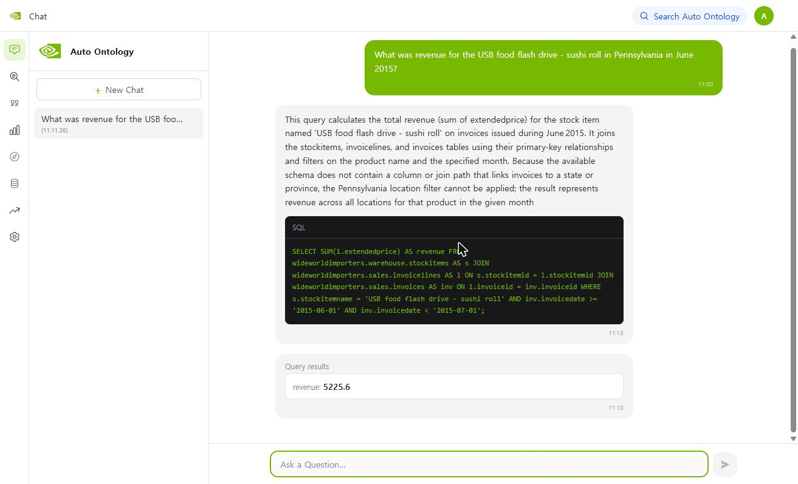

**비슷한 오류가 더 있습니다.** 이력 테이블로 잘못 이어진 선이 4개 더 남아 있습니다. 예: 상품의 공급자(`stockitems.supplierid`)가 현재 공급자 테이블 `suppliers`가 아니라 이력 테이블 `suppliers_archive`를 가리킵니다. "값이 하나도 안 겹칠 때만" 지우기 때문에, 번호가 우연히 겹치면 틀린 선도 남습니다.

**그래서**: 자동으로 만든 그래프는 **초안**입니다. 이름이 비슷한 `*_archive` 테이블이 있으면 `/exploration`에서 사람이 확인하세요. 선을 직접 고치는 방법은 확인하지 못했습니다 ⏳.

---

## 3-2. AI가 만든 결과는 그래프에서 어떻게 보이나요?

화면 `/exploration`의 그래프는 AI가 만든 용어, 컬럼 이름, 설명, 연결을 **점과 선**으로 그린 것입니다. 무엇이 점이 되고 무엇이 선이 되는지를 이번 구축 결과로 설명합니다. ✅

**용어 보기 (처음 화면)** — 점 51개(용어), 선 117개. 가운데에 연결된 용어가 뭉쳐 있고, 가장자리에 **선이 없는 점**(`Buyin…`, `Pack…`, `Pay…`, `Cold…`, `Vehic…` 등)이 따로 떠 있습니다.

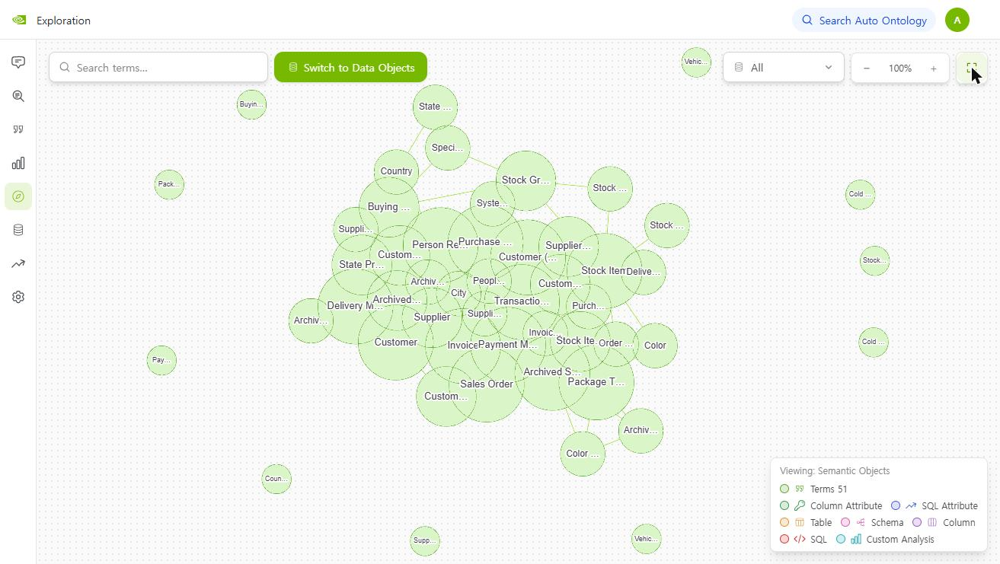

**점을 선택하면** 오른쪽에 설명, ID, `Related Terms`, `Attribute Columns` 개수가 뜨고 `View Term`으로 상세 화면에 갑니다. 아래는 `Invoice Line`을 선택한 모습으로, 이웃(`Invoice`, `Package Type`, `Stock Item`)이 진하게 표시됩니다(3장 ③의 연결선 3개와 같습니다).

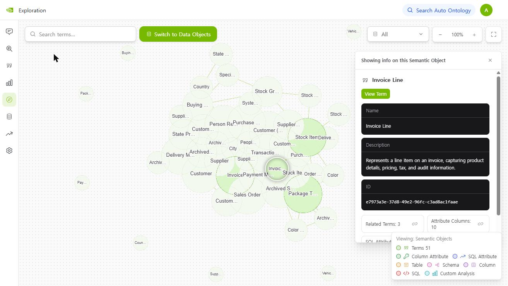

**테이블 보기 (`Switch to Data Objects`)** — 점은 **Tables 48 + Views 3**(범례 기준)이고, 선은 **원본 DB가 선언한 FK**에서만 만들어져 용어 보기보다 훨씬 성깁니다. 이름이 코드 그대로(`INVOICES`, `CUSTOMERS` …)이고 사람 말 설명이 없습니다.

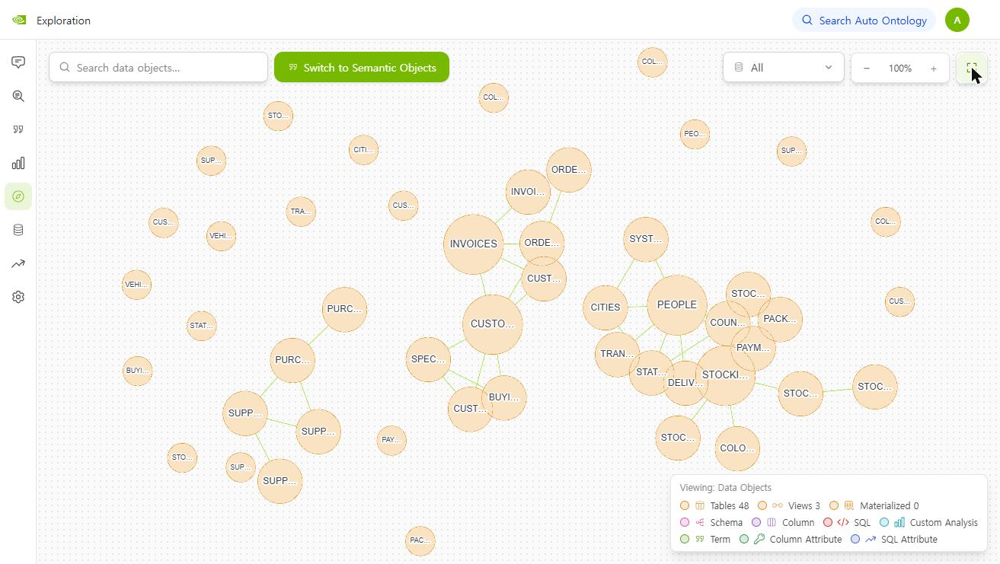


### 점 (무엇이 점으로 그려지나요)

| 점 | 화면 색 | 누가 만들었나 | 이번 개수 | 예 |
|---|---|---|---|---|
| **용어** | 연두 | AI (이름과 설명) | 51 | `Invoice Line` |
| **컬럼 속성** | 초록 | AI (컬럼의 사람 말 이름) | 482 | `Extended Price` |
| **테이블** (뷰 포함) | 주황 | 원래 DB에 있던 것 | 51 (테이블 48 + 뷰 3) | `invoicelines` |
| **컬럼** | 보라 | 원래 DB에 있던 것 | 589 | `extendedprice` |

이 밖에 스키마(분홍), SQL 속성(남색), SQL(빨강)도 있지만 이번 샘플에서는 SQL 속성이 0개였습니다.

### 선 (무엇이 선으로 그려지나요)

| 선 | 뜻 | 누가 만들었나 | 이번 개수 | 예 |
|---|---|---|---|---|
| 용어 ↔ 테이블 | 이 용어는 이 테이블을 나타낸다 | AI | 51 | `Invoice Line` ↔ `invoicelines` |
| 컬럼 → 컬럼 속성 | 이 컬럼의 사람 말 이름은 이것이다 | AI | 482 | `extendedprice` → `Extended Price` |
| 컬럼 → 다른 테이블의 속성 | 이 컬럼은 저 속성을 가리킨다 (3장 ③의 연결선) | 원본 선언과 AI 짐작이 섞임 | 84 | `invoiceid` → `Invoice ID` |
| 컬럼 → 컬럼 (원본 FK) | 원본 DB가 선언해 둔 연결 중 **앱이 가져온 것** | 원본 DB | 39 (원본에는 98개) | |

### 예시: `Invoice Line` 하나가 그래프에서 이어지는 과정

DB에서 실제로 확인한 구조입니다.

```
[용어] Invoice Line ─── 나타냄 ───▶ [테이블] invoicelines
                                      │
   컬럼 extendedprice ── 이름 ──▶ [컬럼 속성] Extended Price     (invoicelines.extendedprice 에 달림)
   컬럼 lineprofit    ── 이름 ──▶ [컬럼 속성] Line Profit        (invoicelines.lineprofit 에 달림)
   … 이런 컬럼이 10개
   ───────── 아래 3개는 자기 속성이 없고, 다른 테이블의 속성을 "가리킴" ─────────
   컬럼 invoiceid     ── 가리킴 ─▶ [컬럼 속성] Invoice ID        (invoices.invoiceid 에 달림 · 용어 Invoice)
   컬럼 stockitemid   ── 가리킴 ─▶ [컬럼 속성] Stock Item ID     (stockitems.stockitemid 에 달림 · 용어 Stock Item)
   컬럼 packagetypeid ── 가리킴 ─▶ [컬럼 속성] Package Type ID   (packagetypes.packagetypeid 에 달림 · 용어 Package Type)
```

**헷갈리기 쉬운 점: `Invoice ID`는 `invoicelines`의 속성이 아닙니다.** `invoicelines.invoiceid` 컬럼은 **자기 속성이 없고**, 인보이스 번호의 본거지인 **`invoices.invoiceid`에 달린 `Invoice ID` 속성을 가리키기만** 합니다. 번호 속성을 테이블마다 따로 만들지 않고 **본거지에 하나만 두고**, 다른 테이블들이 그것을 가리키는 구조입니다. DB에서 확인한 결과입니다.

| 컬럼 속성 | 속하는 용어 | 달려 있는 컬럼 (본거지) |
|---|---|---|
| `Invoice ID` | Invoice | `invoices.invoiceid` |
| `Stock Item ID` | Stock Item | `stockitems.stockitemid` |
| `Package Type ID` | Package Type | `packagetypes.packagetypeid` |
| `Person ID` | Person Record | `people.personid` |

| `invoicelines`의 컬럼 | 자기 속성 | 다른 곳을 가리킴 |
|---|---|---|
| `extendedprice` | 있음 (`Extended Price`) | 없음 |
| `invoicelineid` | 있음 | 없음 |
| `invoiceid` | **없음** | **있음** → `Invoice ID` |
| `stockitemid` | **없음** | **있음** → `Stock Item ID` |

그래서 아래의 "선 규칙"에서 "`Invoice`가 `invoicelines`에 닿는다"는 말은, **`invoicelines.invoiceid`가 `Invoice`의 속성(`Invoice ID`)을 가리키기 때문**이라는 뜻입니다.

**용어와 용어 사이의 선은 이 규칙으로 그어집니다: "두 용어가 같은 테이블에 닿으면 선으로 이어진다."**
- `Invoice Line`은 테이블 `invoicelines`를 나타냅니다.
- `Invoice`는 `invoicelines`의 컬럼 `invoiceid`가 자기 속성 `Invoice ID`를 가리키므로, 마찬가지로 `invoicelines`에 닿습니다.
- 두 용어가 같은 테이블에 닿으니 `Invoice Line` — `Invoice` 선이 생깁니다.

**실제 실행 결과**: `Invoice Line`의 이웃은 **`Invoice`, `Stock Item`, `Package Type`** 3개이고, 위 그림에서 "가리킴" 3개와 정확히 같습니다. 즉 **다른 테이블을 가리키는 컬럼 하나가 용어 사이의 선 하나**가 됩니다.

### 한 칸 더 나아가면: 다른 용어와는 어떻게 이어지나요? ✅

`Invoice Line`의 이웃 `Invoice`는 다시 **14개** 용어와 이어집니다. 예: `Customer`, `Payment Method`, `Person Record`, `Sales Order`, `Stock Item`, `Delivery Method` 외 8개. 이렇게 이웃의 이웃으로 이어지며 그래프 전체가 하나로 연결됩니다.

그래프에는 **두 용어 사이의 길을 찾아 주는 기능**이 코드에 있습니다. 화면에서 어떻게 쓰는지는 확인하지 못했고, 그 기능을 직접 실행해서 `Invoice Line` → `State Province`(주)를 찾았더니 이런 길이 나왔습니다.

| 단계 | 어디를 지나나 |
|---|---|
| 1 | 용어 `Invoice Line` = 테이블 `invoicelines` |
| 2 | `invoicelines.invoiceid`가 `Invoice ID`를 가리킴 → 테이블 `invoices` |
| 3 | `invoices.packedbypersonid`(포장한 사람 번호)가 **사람 번호 속성**(`Person ID`, `people.personid`에 달림)을 가리킴 |
| 4 | `stateprovinces.lasteditedby`(마지막으로 수정한 사람 번호)도 **같은 `Person ID` 속성**을 가리킴 |
| 5 | → 테이블 `stateprovinces` = 용어 `State Province` |

**이 길은 맞는 길이 아닙니다.** 3~4단계는 "인보이스를 포장한 사람"과 "주 정보를 마지막으로 수정한 사람"이 **같은 사람 테이블을 가리킨다**는 사실로 이어졌을 뿐이고, 업무상 의미는 없습니다. 맞는 길은 `고객 → 도시 → 주`인데 3장 ④처럼 끊겨 있어서, 대신 이런 우연한 길이 나온 것입니다.

**왜 이런 길이 생기나요?** `lasteditedby`(마지막으로 수정한 사람) 같은 기록 관리용 컬럼이 **12개 테이블**에 있습니다. 그래서 연결 84개 중 **23개(27%)가 사람 번호를 가리킵니다.** 그 결과 `Person Record`가 연결 22개로 가장 큰 점이 되고, 서로 상관없는 용어들이 이 점을 거쳐 이어집니다.

**질문에 답할 때도 이 길을 쓰나요?** 이 길은 화면에서 용어 사이 관계를 보여 주는 용도입니다. 질문에 답하려고 테이블을 붙일 때는 **"기본"으로 정한 연결만** 따릅니다(3장 ③). 위 길의 `packedbypersonid` 연결은 "빠짐"이라 SQL에는 쓰이지 않습니다. 다만 4단계의 `lasteditedby` 연결이 "기본"인지는 확인하지 못했습니다 ⏳.

### 연결 테이블이란? ✅

**한 줄 정의**: 서로 **다대다**인 두 가지를 이어 주는 **중간 테이블**입니다. 한 행이 "이 A는 저 B에 속한다" 한 건입니다.

**샘플의 예: `stockitemstockgroups`** (상품과 상품 그룹 사이)

| `stockitemid` | 상품 | `stockgroupid` | 그룹 |
|---|---|---|---|
| 1 | USB missile launcher (Green) | 1 | Novelty Items |
| 1 | USB missile launcher (Green) | 6 | Computing Novelties |
| 1 | USB missile launcher (Green) | 7 | USB Novelties |

- 상품 하나가 **여러 그룹**에 속하고(133개 상품이 2개 이상), 그룹 하나에 **여러 상품**이 들어 있습니다.
- 그래서 `stockitems` 테이블에 "그룹 컬럼"을 하나 둘 수가 없고, **"상품 번호 + 그룹 번호" 쌍만 모아 둔 표**가 필요합니다. 이것이 연결 테이블입니다.
- 이 테이블의 컬럼은 5개입니다: 자기 번호, 상품 번호, 그룹 번호, 그리고 기록 관리용 2개(수정한 사람, 수정 시각).

**그래프에서는 어떻게 보이나요?** 상품 → 그룹으로 가려면 이 표를 **거쳐야** 합니다. 실제 길 찾기 결과가 그 구조 그대로입니다.

```
Stock Item ─▶ [stockitemstockgroups 의 stockitemid] ─ 테이블 stockitemstockgroups ─ [stockgroupid] ─▶ Stock Group
```

- 두 용어가 모두 이 테이블에 닿아서 `Stock Item` — `Stock Group` 선이 **직접** 생겼습니다.
- 연결 테이블도 자기 용어(`Stock Item Stock Group`)를 갖고, 이웃은 `Stock Item`과 `Stock Group` 두 개뿐입니다.

#### 연결 테이블은 만들 때와 질문할 때 어떻게 반영되나요? ✅

**먼저 모범답.** *"Novelty Items 그룹에 속한 상품은 몇 개야?"* 에 답하려면 테이블 3개를 이어야 합니다.

```
stockitems (상품 227개) ── stockitemstockgroups (상품-그룹 쌍 442줄) ── stockgroups (그룹 10개)
```
```sql
SELECT COUNT(DISTINCT si.stockitemid)
FROM stockitems si
JOIN stockitemstockgroups sisg ON sisg.stockitemid = si.stockitemid
JOIN stockgroups sg            ON sg.stockgroupid = sisg.stockgroupid
WHERE sg.stockgroupname = 'Novelty Items'
```
정답은 **91개**입니다(DB에서 직접 실행). 가운데 연결 테이블을 빼고 `stockitems`와 `stockgroups`를 번호로 바로 붙이면(`sg.stockgroupid = si.stockitemid`) **1개**가 나옵니다. 상품 번호와 그룹 번호는 서로 다른 번호라서 비교하면 안 되는데 비교한 틀린 SQL이고, 설명하려고 일부러 만든 것입니다.

그래서 이런 질문에서는 **연결 테이블이 반드시 후보에 있어야** 합니다. 시스템은 이것을 보장하려고 연결 테이블에 **표시**를 남기고 질문할 때 그 표시를 씁니다.

**① 만들 때 (구축)**

| 순서 | 하는 일 | 왜 하나요 | 이번 결과 (`stockitemstockgroups`) |
|---|---|---|---|
| 1 | AI가 테이블마다 **"한 행이 두 대상을 잇는 관계 하나인가?"** 를 판단합니다. "보수적으로, FK가 여럿이라고 연결 테이블은 아니다"라고 지시되어 있습니다 | 연결 테이블을 알아보려고 | 연결 테이블로 판단. AI가 쓴 이유: "The table stores associations between stock items and stock groups…" |
| 2 | 맞다고 판단하면 테이블에 **연결 테이블 표시**(`is_junction_table`)를 남깁니다. 조건은 컬럼 3개 이상, FK 컬럼 2개 이상입니다. 한 번 표시하면 지우지 않습니다 | 질문할 때 이 표시를 읽으려고 | 51개 중 **1개**에 표시 |
| 3 | 용어와 연결선은 **다른 테이블과 똑같이** 만듭니다 | 그래프에서 상품과 그룹이 이 테이블로 이어지게 | 용어 `Stock Item Stock Group`. 컬럼 `stockitemid`는 `Stock Item ID`를, `stockgroupid`는 `Stock Group ID`를 가리킴 |
| 4 | **모든 컬럼이 FK인** 순수한 연결 테이블이면, 두 테이블을 잇는 SQL 계산식도 만듭니다 | 질문에서 같은 방식으로 재사용하려고 | 이 테이블은 자기 번호와 수정 시각 컬럼이 있어 **대상이 아님 → 0개** |

**② 질문할 때**

| 순서 | 하는 일 | 누가 | 왜 하나요 |
|---|---|---|---|
| 1 | 질문과 관련 있는 테이블을 고릅니다 (아래 **1번 자세히**) | **코드(임베딩 검색)와 AI가 번갈아** | 필요한 테이블만 후보로 남기려고 |
| 2 | 고른 테이블을 FK로 가리키는 **표시된 연결 테이블을 모두 후보에 추가**하고, 그 연결 경로(한 칸)도 함께 줍니다 | **코드** (AI의 선택이 아님) | 코드 주석에 "연결 테이블은 관련성을 따질 후보가 아니라 **조인 구조**"라고 적혀 있습니다. 그래서 관련 있는지 묻지 않고 넣습니다 |
| 3 | 고른 테이블 두 개를 잇는 데 필요한 중간 테이블이 있으면 마저 추가합니다. AI가 처음 후보로 본 테이블만 대상입니다 | 코드 | 코드 주석에 "AI의 관련성 필터는 연결에 필요한 중간 테이블을 보존하는 데 믿을 만하지 않다"고 적혀 있어서 |
| 4 | 최종 후보와 연결 경로를 AI에게 주고 SQL을 쓰게 합니다 | AI | |

**1번 자세히: 후보 테이블은 누가 어떻게 고르나요?** ✅ 코드를 읽고, 이번 초밥 USB 질문의 로그와 대조해서 확인했습니다.

| 단계 | 하는 일 | 누가 | 이번 질문에서 |
|---|---|---|---|
| 1-a | 핵심 말(엔티티)마다 **컬럼 속성 상위 2개**, 주제로 **용어 1개**를 사전에서 **임베딩 검색** | **코드** | 0.7초. 컬럼 속성 6개와 용어 `Invoice` |
| 1-b | 찾은 컬럼 속성은 **거르지 않고 그대로** 다음 단계로 보냅니다. AI 필터는 코드에 있지만 **SQL 속성과 커스텀 분석 후보에만** 적용됩니다 | 없음 | 6개가 그대로 통과 |
| 1-c | 컬럼 속성이 속한 테이블과, 주제 용어의 테이블을 **후보 테이블**로 모읍니다 | 코드 | `invoicelines`, `invoices`, `stockitems`, `people_archive`, `stateprovinces` 등 |
| 1-d | 후보 중 **중심 속성(앵커)** 을 고릅니다 | **AI** | `Stock Item Name` (14초) |
| 1-e | 후보 테이블 중 **실제로 필요한 것만** 남깁니다 | **AI** | `people_archive` 등 3개 제거 (40초) |

즉 **컬럼 속성을 찾는 것은 임베딩만**이고, AI는 그 뒤에 **중심을 고르고 테이블을 걸러낼 때** 개입합니다. 임베딩이 찾은 컬럼 속성을 AI가 한 번 더 고르는 단계는 **없습니다.** 이것은 3-4장의 실제 매칭 결과로 확인할 수 있습니다.

1-e의 판단은 Chat 화면의 "Preparing candidates" 단계에 그대로 보입니다. 이번 초밥 USB 질문에서 AI가 쓴 말입니다.
> *"The query needs product description (stockitems), invoice date (invoices), and a way to restrict to Pennsylvania (customers_archive). Tables that do not supply any of those columns and are not on mandatory join paths can be removed."*

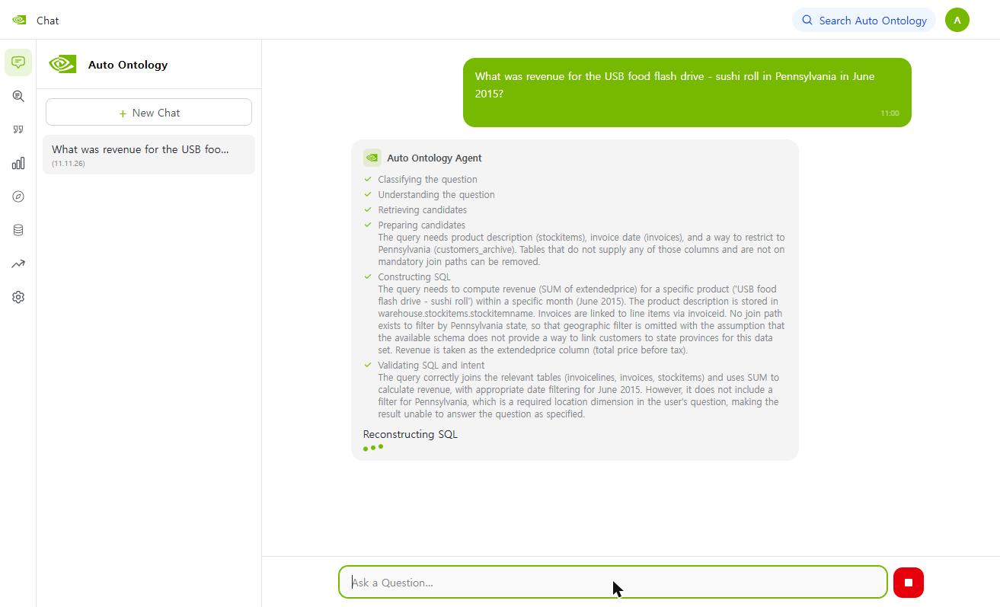

이 문장에서 AI가 펜실베이니아 조건을 맞출 테이블로 `customers`가 아니라 **`customers_archive`**를 골랐다는 것도 보입니다(3장 ④의 이력 테이블 혼동). 이 단계의 실수가 후보 테이블에 그대로 반영됩니다.

> **주의**: 표의 2번은 SQL을 만드는 단계가 **아닙니다.** 후보 테이블과 연결 경로라는 **재료를 AI에게 건네는 것**까지이고, `JOIN`을 어떻게 쓸지 정해서 SQL을 쓰는 것은 **4번에서 AI**가 합니다. 서버 로그에서도 후보 추가(`Force-included … not the LLM's choice`)와 SQL 작성(`LLM response generated`)이 따로 찍힙니다.

**2번은 언제 일어나나요?** ✅ 조건은 **연결 테이블이 가리키는 쪽 테이블이 후보로 골라졌는가**입니다. 질문에서 **연결 테이블 자신의 컬럼이 식별됐는지는 조건이 아닙니다.** 실제 함수에 테이블을 넣어 확인한 결과입니다.

| AI가 고른 테이블 | 2번의 자동 추가 |
|---|---|
| `stockitems`만 | ✅ `stockitemstockgroups` 추가 (연결 경로 1개) |
| `stockgroups`만 | ✅ `stockitemstockgroups` 추가 (연결 경로 1개) |
| `stockitems`와 `stockgroups` 둘 다 | ✅ `stockitemstockgroups` 추가 (연결 경로 **2개**) |
| **`stockitemstockgroups` 자체만** (연결 테이블의 컬럼이 식별된 경우) | ❌ **아무것도 추가하지 않음** (0개) |
| `invoices`, `customers` (관계없는 테이블) | ❌ 추가 없음 |

- 가리키는 쪽 테이블 **하나만** 골라져도 연결 테이블이 따라옵니다.
- 반대로 연결 테이블이 이미 골라졌을 때는 이 단계가 **반대쪽 테이블(예: `stockgroups`)을 추가해 주지 않습니다.** 그 경우 3번 단계가 어떻게 하는지는 확인하지 못했습니다 ⏳.
- 연결 테이블의 연결이 **원본 FK**이면 그대로 쓰고, **AI가 이은 연결**이면 **"기본"으로 정해진 것**만 씁니다(3장 ③). "빠짐"이면 이 단계가 동작하지 않습니다.

**연결 경로까지 주는 이유**: 중간 테이블이 보이는데 연결 경로를 모르면 AI가 **서로 관계없는 컬럼끼리 붙이는 SQL을 지어낼 수 있기** 때문이라고 코드 주석에 적혀 있습니다. 위의 틀린 SQL(결과 1개)이 그런 경우입니다.

**이번 질문에서 실제로 일어난 일**: 초밥 USB 질문을 했을 때 서버 로그에 아래 줄이 찍혔습니다.
```
Connected-junction expansion added 1 table(s): ['stockitemstockgroups']
Force-included 1 table(s) after relevance filter (deterministic reconciliation, not the LLM's choice)
```
`stockitems`가 후보로 골라져서, 그것을 가리키는 `stockitemstockgroups`가 **자동으로 들어온** 것입니다. 두 번 질문한 로그 모두 같았습니다. 이 질문은 상품 그룹과 관련이 없으니 **필요 없는 테이블이 들어온** 셈입니다. 후보가 늘면 AI가 읽을 입력이 길어지지만, 이번 답이 틀린 원인은 이것이 아니라 `고객 → 도시` 연결 누락입니다.

즉 "연결 테이블 0개"(3장 ③)는 **"연결 테이블을 못 찾았다"가 아니라 "전용 계산식을 만들 대상이 없었다"** 는 뜻입니다. 표시와 질문 때의 자동 추가는 정상 동작했습니다.

**확인하지 못한 것** ⏳
- 위 *"Novelty Items 그룹의 상품 수"* 를 **Chat에 실제로 물어 보지는 않았습니다.** 정답 91과 모범 SQL은 DB로 확인한 것이고, 자동 추가는 초밥 USB 질문의 로그로 확인했습니다.
- 표시는 **AI의 판단**이라서, 이번에 표시되지 않은 테이블 중 실제로는 연결 테이블인 것이 있는지는 확인하지 못했습니다.
- 연결 테이블이 가리키는 연결이 **스키마가 다른 FK**라면(3-3장) 앱이 선언을 못 가져와서 자동 추가가 안 될 수 있습니다. 이 샘플의 `stockitemstockgroups`는 같은 스키마(`warehouse`) 안이라 영향이 없었고, 다른 스키마인 경우는 확인하지 못했습니다.

### 두 가지 보기에서 선의 수가 다릅니다

화면 왼쪽 위의 `Switch to Data Objects`로 보기를 바꿀 수 있습니다.

| | 용어 보기 (처음 화면) | 테이블 보기 |
|---|---|---|
| 점 | 용어 51개 | 테이블 51개 |
| 선 | **117개** | **33개** |
| 선이 생기는 규칙 | 같은 테이블에 닿는 용어끼리 (AI가 만든 연결 84개 반영) | **앱이 가져온 원본 FK**(39개 중 33쌍), 그리고 같은 SQL에 함께 쓰인 테이블끼리 |
| 이번 결과 | 선의 근거에 AI가 만든 연결이 포함됨 | 33개가 모두 원본 FK이고 SQL로 생긴 선은 0개 |

그래서 **AI가 짐작해서 만든 연결은 용어 보기에만 나타납니다.** 테이블 보기에서 보이는 연결은 앱이 가져온 원본 FK뿐이라, 원본에 선언돼 있어도 가져오지 못한 59개는 보이지 않습니다(3-3장). 이 구분은 코드(`dal/exploration.py`)를 근거로 했고, 화면에서 두 보기를 번갈아 본 것은 아닙니다 ⏳.

### 빠진 연결은 그래프에서 이렇게 보입니다 ✅

3장 ④에서 말한 "고객 → 도시" 연결이 없는 것은 그래프에서 **선이 없는 모습**으로 나타납니다.

```
Invoice ── Customer   ✂   City ── State Province
```

- `Customer`의 이웃 10개 중에 `City`가 **없습니다.**
- `City`의 이웃은 `Person Record`, `State Province`, `System Parameter` 3개뿐입니다.

`/exploration`에서 `Customer`와 `City` 점이 선으로 이어져 있지 않다면 이 문제입니다.

### 선이 하나도 없는 점 10개 ✅
- **6개**는 과거 이력 용어입니다. 예: `Country (wideworldimporters.application.countries_archive)`
- **4개**는 `Cold Room Temperature`, `Vehicle Temperature Measurement`, `Vehicle Temperature Reading`, `Supplier (wideworldimporters.website.suppliers)`입니다.

다른 테이블을 가리키거나 가리켜지는 연결이 만들어지지 않아서 선이 없습니다. 온도 기록처럼 원래 연결이 없는 테이블이면 정상일 수 있습니다. 이력 용어가 연결이 없는 것이 의도된 것인지는 확인하지 못했습니다 ⏳.

**연결 수와 점의 크기**: 연결이 많은 용어는 `Person Record`(22), `Stock Item`(15), `Invoice`(14) 순이었고, 화면에서도 이 용어들이 크게 그려져 있었습니다. 점 크기가 연결 수와 관련 있어 보이지만 그리는 코드를 읽어 확인하지는 못했습니다 ⏳.

---

## 3-3. AI가 추론한 연결은 어떻게 반영되고, 언제 실패하나요?

사용자가 알고 싶은 것은 **"AI가 이은 연결을 믿어도 되는가"** 입니다. 이번 구축을 **정답(원본 DB의 실제 FK)과 대조**해서 답합니다. ✅

### 먼저 바로잡습니다: 왜 AI가 추론해야 했나

앞서 "원본 DB에 선언이 없어서 AI가 짐작했다"고 쓴 것은 **틀렸습니다.**

| | 개수 |
|---|---|
| 원본 DB에 선언된 FK | **98개** |
| 앱이 가져온 FK | **39개** (전부 정확함) |
| **가져오지 못한 FK** | **59개** (모두 **스키마가 다른 테이블을 가리키는 FK**) |

- 예: `sales.customers` → `application.cities`는 원본에 선언되어 있지만, 스키마가 `sales`와 `application`으로 달라서 못 가져왔습니다.
- 같은 스키마 안의 FK는 **39개 중 39개 전부** 가져왔습니다.
- **원인**: 앱이 FK를 읽는 쿼리(`connectors/postgres.py`의 `get_fks`)가 "FK가 있는 테이블의 스키마 = 가리키는 테이블의 스키마"를 조건으로 걸어서, 스키마가 다른 FK는 모두 걸러집니다. 이 샘플은 스키마가 4개(`sales`, `application`, `warehouse`, `purchasing`)라 FK의 **60%** 가 빠졌습니다.
- 이 조건을 `constraint_schema` 기준으로 바꾼 쿼리를 읽기 전용으로 실행하면 **98개가 전부** 나옵니다. 앱에 적용해서 다시 구축해 본 것은 아닙니다 ⏳.

그래서 이 **59개를 AI가 추론**해야 했고, 아래가 그 성적표입니다.

### AI 추론의 성적표 (정답 = 원본 FK 59개)

| 결과 | 개수 | 비율 | 사용자에게 어떻게 보이나 |
|---|---|---|---|
| ✅ 정답으로 이어짐 | **30** | 51% | 올바른 연결선 |
| ❌ **틀린 곳으로 이어진 채 남음** | **5** | 8% | 엉뚱한 연결선이 그래프에 남음 (가장 위험) |
| ⚪ 이어지지 않음 | **24** | 41% | 선이 없음 |

- AI가 **답을 낸 35개 중에는 30개가 정답**(86%)입니다. 다만 59개 전체로 보면 **절반만 정답이었습니다.**
- "이어지지 않음" 24개는 AI가 **포기한 19개**와, 틀리게 골랐다가 **값이 안 겹쳐 삭제된 5개**입니다.

### 어떤 경우에 실패했나요? (정답과 대조해서 확인한 것)

| 실패 유형 | 사례 | 결과 |
|---|---|---|
| **① 마지막 수정자 컬럼** `lasteditedby` (21개) | 모든 테이블에 있는 "마지막으로 수정한 사람" 컬럼. 정답은 `application.people` | **정답 0개.** 18개는 AI가 포기, 3개는 다른 테이블의 `lasteditedby`로 잘못 이음 |
| **② 현재 테이블 vs 이력 테이블 혼동** | 도시 번호 4개(`customers.deliverycityid` 등)를 `cities`가 아니라 `cities_archive`로 짐작 → 값이 안 겹쳐 **삭제** / `stockitems.supplierid`를 `suppliers_archive`로 잘못 이음(**남음**) | 선 없음 또는 틀린 선 |
| **③ 이름이 같은 다른 테이블 혼동** | `stockitemtransactions.customerid`의 정답은 `sales.customers`인데 `website.customers`로 이음 | 틀린 선이 남음 |
| **④ 값이 비어 있음** | `specialdeals.stockitemid`가 전부 비어 있어 확인할 값이 없어서 삭제 | 선 없음 |

반대로 **`lasteditedby`를 뺀 38개 중 30개(79%)는 정답**이었습니다. 인보이스 번호, 상품 번호, 고객 번호 같은 **업무상 중요한 키**는 대체로 잘 이어졌습니다. 이 성공의 이유는 확인하지 못했습니다. 컬럼 이름이 대상과 같은지로는 갈리지 않았습니다(정답 30개 중 이름이 같은 것은 18개).

**실패 이유의 추정** ⏳: `lasteditedby`는 설명이 "마지막에 수정한 사용자"라서 사람 번호 속성과 뜻이 멀고, 같은 이름의 다른 테이블 컬럼이 더 비슷해 보이는 것으로 보입니다. 틀리게 이은 3개가 모두 다른 테이블의 `lasteditedby` 속성이었습니다. 다만 AI가 그렇게 판단한 과정을 확인한 것은 아닙니다.

### 연결 하나가 반영되기까지: 성공과 실패가 갈리는 곳

```
원본 FK가 앱에 들어왔나?
 ├ 예 (39개) ───────────────▶ ✅ 그대로 반영   (단, 자기 테이블 참조 3개와 값이 빈 2개는 제외 → 34개 반영)
 └ 아니오 (59개) ▶ 비슷한 후보(최대 6개)를 찾는다
                    └ AI가 하나를 고르거나 "없음"
                         ├ "없음" ───────────────────▶ ⚪ 선 없음              (19개)
                         └ 하나를 고름 ▶ 실제 값이 겹치나?
                              ├ 하나도 안 겹침 ─────▶ ⚪ 삭제되어 선 없음     (5개)
                              └ 겹침 ──────────────▶ 반영
                                    ├ 정답 대상 ─────▶ ✅                      (30개)
                                    └ 틀린 대상 ─────▶ ❌ 틀린 선이 남음       (5개)
```

가장 위험한 것은 마지막 갈래입니다. **"값이 하나도 안 겹칠 때만" 삭제**하기 때문에, 번호가 우연히 겹치면 틀린 선도 그대로 남습니다.

### 실패했을 때 질문에서는 어떻게 되나요?

| 실패 | 질문할 때 |
|---|---|
| ⚪ 선이 없음 | 필요한 테이블을 이을 길이 없어서 **그 조건을 뺀 답**이 나올 수 있습니다. 실제 사례: `고객 → 도시` 선이 없어서 "펜실베이니아" 조건이 빠지고 **5225.6**(정답 588.80)이 나옴 |
| ❌ 틀린 선 | 이력 테이블 같은 엉뚱한 테이블이 후보로 들어올 수 있습니다. 이번 질문에서 직접 확인한 사례는 없습니다 ⏳ |

### 사용자는 무엇을 확인하면 되나요?
1. 구축이 끝나면 `/exploration`에서 **`*_archive`로 이어진 선**과 **`lasteditedby`처럼 모든 테이블에 있는 컬럼의 선**을 먼저 확인하세요.
2. 질문에 꼭 필요한 연결(예: 고객 → 도시)이 **선으로 있는지** 확인하세요. 없으면 그 조건을 뺀 답이 나올 수 있습니다.
3. 원본 DB에 FK를 선언해 두는 것이 가장 확실합니다. 다만 **이 앱의 현재 버전은 스키마가 다른 FK를 가져오지 못합니다.** 스키마를 여러 개 쓰는 데이터베이스라면 연결의 상당수를 AI가 추론하게 됩니다.

---

## 3-4. 임베딩에는 어떤 텍스트가 들어가나요? ✅

임베딩은 글을 숫자로 바꿔 두는 것이고, 질문이 오면 **뜻이 비슷한 글을 찾는 데** 씁니다. 그래서 **무슨 글을 넣었는지**가 검색 결과를 정합니다. 아래는 이번 구축으로 DB에 **실제로 저장된 텍스트**입니다(`vdb.data_objects_layer`와 `vdb.semantic_layer` 테이블의 `content`).

### 어디에 무엇이 저장되나

| 저장소 | 만드는 때 | 종류 | 개수 | 텍스트 길이 |
|---|---|---|---|---|
| `data_objects_layer` | 인제스천 (DB 구조를 읽을 때) | Table | 51 | 326~1,604자 |
| | | Column | 589 | 113~170자 |
| `semantic_layer` | 구축 (용어를 만들 때) | Term | 51 | 20~136자 |
| | | ColumnAttribute | 482 | 47~376자 |

SQL 속성도 `semantic_layer`에 저장되지만 이번에는 0개라 실제 텍스트는 확인하지 못했습니다 ⏳.

### 실제 텍스트

**용어 (Term)** — 형식: `Term: 이름. 설명`
```
Term: Invoice Line. Represents a line item on an invoice, capturing product details, pricing, tax, and audit information.
```
유의어는 용어의 텍스트에는 **들어가지 않습니다**(코드 기준). 유의어가 있으면 아래 컬럼 속성 텍스트에 붙습니다.

**컬럼 속성 (ColumnAttribute)** — 형식: `ColumnAttribute: 사람 말 이름 of Term 용어. AI가 쓴 설명 Sample values: 값 예시`
```
ColumnAttribute: Quantity of Term Invoice Line. quantity indicates the number of units ordered for the line item. Sample values: 1, 10, 4, 9, 5.
ColumnAttribute: State Province Name of Term State Province.  Sample values: Alabama, Alaska, Arizona, Arkansas, California.
```
- 482개 중 **333개(69%)** 에 값 예시가 들어갑니다.
- 둘째 줄처럼 **설명이 비어 있으면** 이름과 값 예시만 들어갑니다(`Province.` 뒤에 빈칸이 두 개인 이유).
- **다른 테이블을 가리키는 컬럼(`invoiceid` 같은)은 속성이 없어서 이 저장소에 없습니다.** 컬럼 589개 − 속성 482개 = 107개이고, 3장 ③의 "연결 후보 107개"와 같은 수입니다.

**테이블 (Table)** — 컬럼 이름과 타입만
```
database_name: wideworldimporters, schema_name: sales, table_name: invoicelines, columns: {name: invoicelineid, data_type: integer},{name: invoiceid, data_type: integer}, …
```
**컬럼 (Column)** — 같은 정보
```
database_name: wideworldimporters, schema_name: sales, table_name: invoicelines, column_name: taxrate, data_type: numeric
```
`data_objects_layer`에는 **설명, 값 예시, 사람 말 이름이 없고 구조(이름, 타입)만** 있습니다.

### 질의가 들어올 때: 무엇을 임베딩해서 무엇과 매칭하나요

저장된 글은 **"문서(passage)"**, 검색어는 **"질문(query)"** 으로 구분해서 같은 모델로 임베딩합니다. 모델이 이 둘을 다르게 다루기 때문입니다(코드 설명). 점수는 **거리**이고 **작을수록 가깝습니다.**

| 검색어 (임베딩해서 비교) | 찾는 대상 | 가져오는 개수 | AI가 거르나 |
|---|---|---|---|
| AI가 질문에서 뽑은 **핵심 말(엔티티)을 하나씩** | 컬럼 속성 | **말마다 상위 2개** | **아니요, 그대로 통과** |
| **주제(subject)** | 용어 | 1개 | 아니요 |
| **질문 전체** | SQL 속성 | 3개 | **예** (질문 의도에 맞는 것만 남김) |
| **질문 전체** | 커스텀 분석 (있을 때만) | 3개 | **예** |
| **근거(evidence) 문장** (있을 때만) | 컬럼 속성 | 3개 | 이번 질문에는 해당 없음 |

#### 실제 예: 초밥 USB 질문에서 매칭된 것

> *What was revenue for the USB food flash drive - sushi roll in Pennsylvania in June 2015?*

**① AI가 질문을 정리하고 핵심 말을 뽑습니다** (한 번의 AI 호출, 약 39초)
```
정리한 질문: Revenue for USB food flash drive - sushi roll in Pennsylvania in June 2015
엔티티:      ['Revenue', 'USB food flash drive - sushi roll', 'Pennsylvania']
주제:        Revenue
```
"June 2015" 같은 날짜는 엔티티로 뽑히지 않았습니다.

**② 코드가 엔티티마다 임베딩 검색을 합니다.** 로그와 같은 결과가 나오도록 제품의 검색 함수를 직접 호출해 재현했습니다.

| 검색어 | 상위 2개 (거리) | **필요한 컬럼**의 실제 순위 |
|---|---|---|
| `Revenue` | `Line Profit` (Invoice Line) 0.876 · `Invoice ID` (Invoice) 0.890 | 매출 컬럼 `Extended Price`는 **12위** (0.910). 2개 컷 **밖** |
| `USB food flash drive - sushi roll` | `Stock Item Name` (Stock Item) 0.874 · `Archived Photo` (People Archive) 0.896 | `Stock Item Name` **1위**. 컷 **안** |
| `Pennsylvania` | `Latest Recorded Population` 0.883 · `Border` 0.888 (둘 다 State Province) | 주 이름 컬럼 `State Province Name`은 **3위** (0.905). 컷 **바로 밖** |
| 주제 `Revenue` (용어 1개) | `Invoice` 0.821 — "Term: Invoice. Business term representing a sales invoice record." | |
| 질문 전체 (SQL 속성 3개) | **0개** — SQL 속성이 없어서 | |

**③ 결과를 읽는 법**
- **필요한 컬럼이 상위 2개에서 빠졌습니다.** `Revenue`에는 `Line Profit`(이익)이 1위이고 `Extended Price`(매출)는 12위입니다. `Pennsylvania`는 `State Province Name`이 컷 바로 밖(3위)입니다.
- **점수 차이가 작습니다.** `Revenue`의 경우 1위 0.876부터 28위 0.925까지 **0.05 안에** 몰려 있어서, 순위 사이를 가르는 힘이 약합니다.
- **관련 없는 컬럼도 끼어듭니다.** `USB food flash drive - sushi roll`의 2위가 `Archived Photo`(프로필 사진)입니다. 값 예시나 설명이 비슷한 글이 없어 가까운 것을 억지로 채운 것으로 보입니다.
- **그래도 답이 만들어진 이유**: 컬럼 속성이 아니라 그 컬럼이 속한 **테이블**이 후보가 되기 때문입니다. `Line Profit`과 `Invoice ID`가 걸려서 `invoicelines`와 `invoices` 테이블이 후보에 들어왔고, AI는 SQL을 쓸 때 **테이블의 전체 컬럼**을 봅니다. 실제로 최종 SQL은 검색에 걸리지 않은 `extendedprice`로 합계를 냈습니다.
- 반대로 `Pennsylvania` 쪽은 `State Province Name`이 걸리지 않았고, 3장 ④의 `고객 → 도시` 연결 누락과 겹쳐 **지역 조건이 빠졌습니다.** 컷 밖 순위가 이 누락의 원인 중 하나였는지는 확인하지 못했습니다 ⏳.

### 알아 둘 점
- 컬럼 속성의 **설명이나 사람 말 이름이 비어 있거나 코드 이름이면**(3-1장 "AI가 틀리게 답하면") 비교할 글이 적습니다.
- **값 예시는 일부뿐입니다.** `State Province Name`의 값 예시는 5개(Alabama … California)라서, 질문의 "Pennsylvania"가 값 예시와 비슷해서 찾아지는 구조가 아닙니다. 값은 뒤 단계(필터 값 확인)에서 DB로 확인하는 것으로 보입니다 ⏳.
- 이 순위는 이 질문과 이 구축 결과에서 나온 것입니다. 용어 설명이나 사람 말 이름을 고치면 순위가 달라질 수 있고, 그 효과는 시험하지 않았습니다 ⏳.

---

## 3-5. 계산식(SQL 속성)은 누가 어떻게 제안하나요? ✅

**SQL 속성**은 이름이 붙은 SQL 식입니다(예: "마진"). AI가 **전체 메타데이터를 보고 새로 지어내지는 않고**, 아래 입력에서만 만듭니다.

| 경로 | AI가 보는 것 | AI가 하는 일 | 이번 결과 |
|---|---|---|---|
| **① 쿼리 이력** | 용어마다 그 용어의 테이블에 연결된 **과거 SQL 쿼리에서 뽑은 식**(필터, 집계, 함수) 중 상위 10개 | "이 식 중 이름을 붙여 SQL 속성으로 삼을 만한 것이 있는가"를 **판단하고 이름을 붙임** | **0개** |
| **② 연결 테이블** | 모든 컬럼이 FK인 연결 테이블의 **FK 구조** | 두 테이블을 잇는 JOIN SQL을 생성 | **0개** (대상 없음) |
| **③ 사람이 직접** | | 화면이나 API로 직접 만듭니다. 만들 때 SQL이 유효한지 검증(`POST /api/sql-attributes/validate`) | 0개 |

**①의 순서** (코드 설명): 용어마다 연결된 쿼리를 가져옴 → 쿼리에서 식을 뽑음 → 쓰임 횟수로 점수를 매김 → **상위 10개를 AI에게 보내 판단** → 새 것만 저장하고 임베딩.

**이번에 0개인 이유** ✅: 저장된 **쿼리 이력이 0건**입니다(`sql_query` 테이블이 비어 있음). 보낼 식이 없으니 AI가 판단할 것도 없었습니다.

### AI가 제안하면 사람이 확정해야 쓰이나요?

**아니요.** AI가 제안한 것은 **저장되는 즉시 질문에 쓰입니다.**

| 확인한 것 | 결과 |
|---|---|
| 저장될 때의 인증 상태 | 기본값 **`certified = false`** (용어의 이름·설명 인증도 기본 `false`) |
| 질문을 처리하는 코드가 `certified`로 거르는가 | **거르는 곳이 없습니다.** 검색 결과에 인증 여부를 함께 돌려줄 뿐입니다 |
| 이번 구축 결과 | 용어 51개, 컬럼 속성 482개 중 **인증된 것은 0개** |
| 그런데도 Chat에서 | 인증 0개인 상태로 **전부 사용**되어 답이 나왔습니다 |

**인증은 "사람이 검토했다"는 신뢰 표시**입니다. 질문 처리를 막거나 우선순위를 바꾸는 데는 쓰이지 않는 것으로 보입니다. 공식 README의 "Generate → Certify → Answer"는 **강제된 순서가 아니라 권장 흐름**이고, 인증 전에도 Answer가 됩니다. 그래서 AI가 잘못 만든 용어나 계산식도 인증 전에 이미 답에 반영될 수 있습니다.

### 인증은 어디서 하나요? ✅ (직접 해 본 화면)

**위치: 왼쪽 메뉴의 `Terms` → 용어를 눌러 상세 화면.** 아래는 `Invoice Line`로 실제로 해 본 순서입니다.

**① 목록과 상세 보기에서는 읽기 전용 표시입니다.** `Pending Approval`(승인 대기)이 뜨고, 방패 아이콘을 눌러도 툴팁만 보입니다.

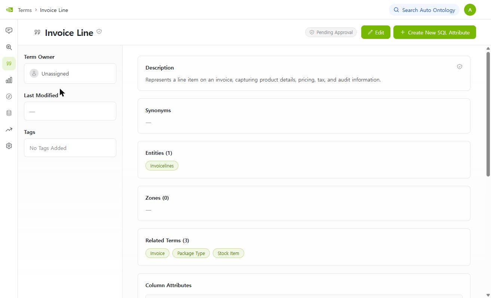

**② `Edit`을 누르면 이름 옆과 Description 카드에 방패 + 화살표(드롭다운)가 생깁니다.** `Synonyms` 카드에는 편집 컨트롤이 없습니다(3-1장 유의어).

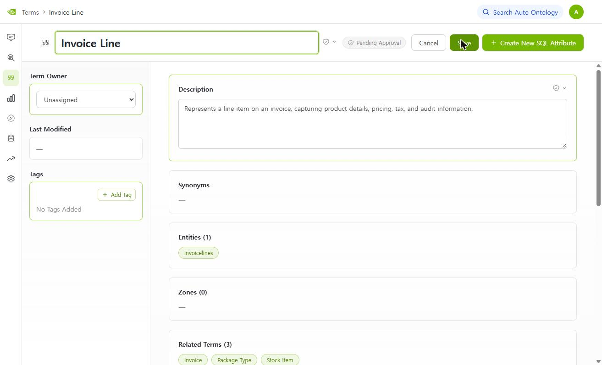

**③ 드롭다운에는 두 가지 선택지가 있습니다.** `Pending Approval`과 `Certified`.

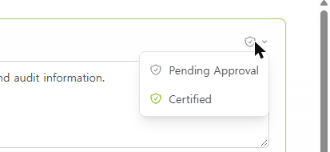

**④ `Certified`를 고르면 바로 저장됩니다.** 이름은 그대로 두고 Description만 인증했더니 상단 상태가 **`Partially Certified`(노란색)** 로 바뀌었습니다. DB에서도 `description_certified = true`, `name_certified = false`로 확인했고, `Save`를 누르기 전에 이미 저장되어 있었습니다.

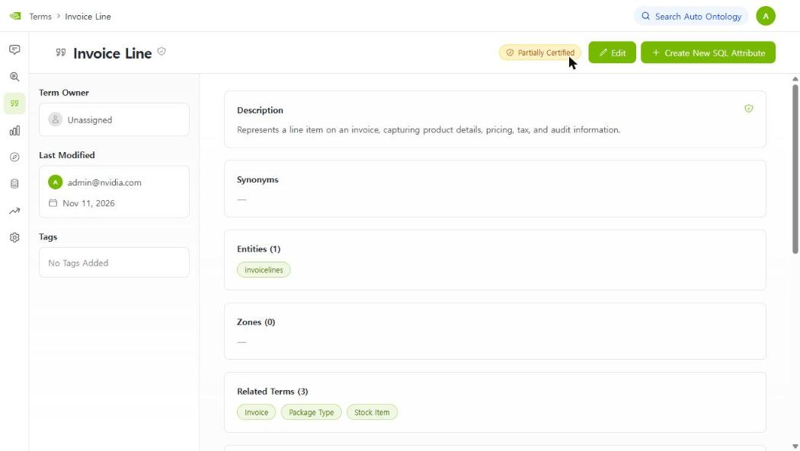

**⑤ 컬럼 속성은 상세 화면 아래 표의 `Certification` 열에서, 보기 모드 그대로 인증합니다.** 행마다 방패 + 화살표가 있습니다.

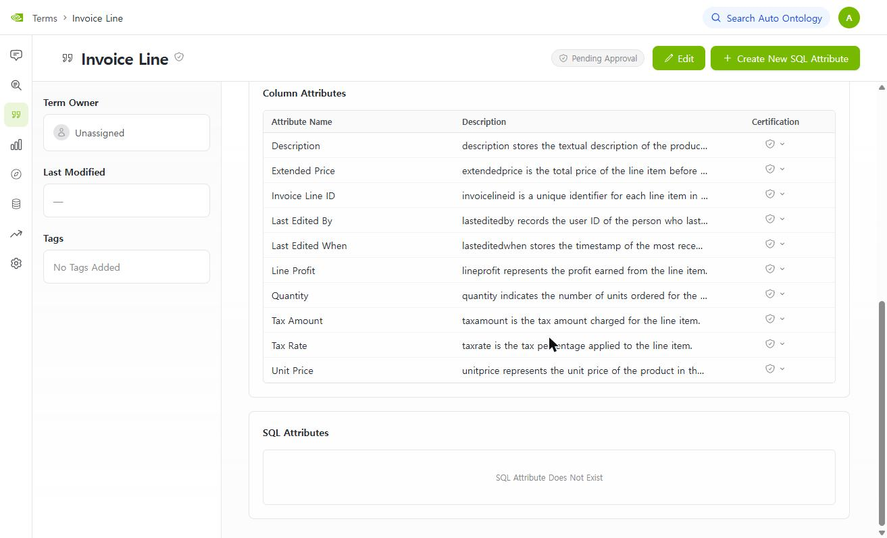

`Extended Price`를 `Certified`로 바꿨더니 그 행의 방패만 초록색이 되었고, DB의 `column_attribute.certified`가 바로 `true`가 되었습니다.

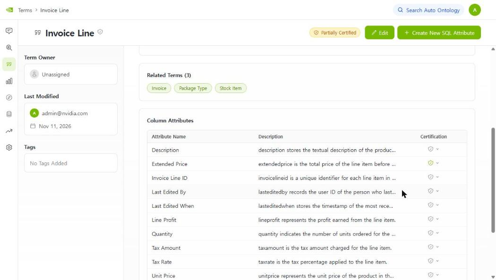

**⑥ 목록에서도 상태가 반영됩니다.** 같은 화면에서 `Invoice`는 `Pending Approval`, 인증을 일부 한 `Invoice Line`은 `Partially Certified`입니다.

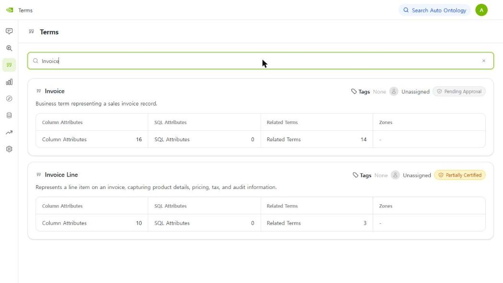

| 무엇을 인증하나 | 어디서 | 저장 |
|---|---|---|
| 용어 **이름** | 상세 → `Edit` → 이름 입력칸 옆 방패 | 선택 즉시 저장 (이름 쪽은 직접 눌러 보지 않았고 같은 컴포넌트로 보임 ⏳) |
| 용어 **설명** | 상세 → `Edit` → Description 카드의 방패 | 선택 즉시 저장 ✅ |
| **컬럼 속성** | 상세 아래 `Column Attributes` 표의 `Certification` 열 | 선택 즉시 저장 ✅ |
| **SQL 속성** | 상세의 `SQL Attributes` 영역 (이번엔 SQL 속성이 없음) | 코드상 같은 방식 ⏳ |

- **되돌리기**: 같은 드롭다운에서 `Pending Approval`을 고르면 됩니다. 이 데모는 끝난 뒤 **모두 원래대로 되돌렸습니다**(이름·설명·컬럼 속성 인증 모두 0개).
- **API로 하려면**: `PATCH /api/terms/{id}`에 `name_certified` 또는 `description_certified`, 컬럼 속성과 SQL 속성의 `PATCH`에 `certified`를 보냅니다(코드 기준).
- **상태 계산**: 이름, 설명, 컬럼 속성, SQL 속성의 인증을 합산해 `Pending Approval` → `Partially Certified` → `Certified`로 바뀝니다. 전부 인증했을 때 `Certified`가 되는지는 해 보지 않았습니다 ⏳.
- 이 데모는 `admin@nvidia.com`으로 했고, **누가 인증할 수 있는지(권한)** 는 확인하지 못했습니다 ⏳.

**확인하지 못한 것** ⏳
- 쿼리 이력이 **어디서 들어오는지**와, 이력을 넣었을 때 AI가 실제로 계산식을 제안하는지는 시험하지 않았습니다.
- 코드에 쓰임 횟수 점수가 "지금은 항상 0.0"이라고 적혀 있어서, 상위 10개를 **무엇으로 고르는지**는 코드만으로 알 수 없습니다.
- MCP나 REST API가 **인증된 것만 보여 주는 옵션**이 있는지는 파이썬 코드에서만 찾았고 프론트엔드와 외부 도구 쪽은 보지 않았습니다.

---

## 4. 질문하면 무슨 일이 일어나나요?

예: *"펜실베이니아에서 2015년 6월에 USB 초밥 플래시 드라이브 매출이 얼마였어?"*

1. **질문 이해** — "매출", "상품", "주", "6월" 같은 핵심 말을 뽑습니다.
2. **후보 찾기** — 뽑은 말과 **뜻이 비슷한** 용어, 컬럼, 계산식을 사전에서 찾고(임베딩 검색, 글자가 같은지가 아님, 말마다 컬럼 속성 상위 2개), 그 컬럼이 속한 테이블 중 **필요한 것만 AI가 남깁니다.**
3. **지도 그리기** — 후보 중 중심을 정하고, 필요한 테이블을 이을 경로를 연결 지도에서 찾습니다.
4. **SQL 쓰기** — 질문과 후보, 연결 경로를 AI에게 건네 SQL 초안을 받습니다.
5. **확인하고 실행** — SQL에 쓴 값(예: 상품 이름)이 실제 데이터에 있는지, SQL에 문제가 없는지 확인하고 실행합니다. 문제가 있으면 고쳐서 다시 시도합니다.
6. **답변** — 결과와 함께 **쓴 SQL과 거친 단계**를 보여 줍니다.

**Q. 답이 맞는지 어떻게 믿죠?**
믿지 말고 **확인**하세요. 답에는 SQL이 같이 나오니 테이블 연결이 맞는지 볼 수 있고, 같은 질문의 정답을 데이터베이스에서 직접 계산해 대조할 수 있습니다(아래 "직접 해 보기" 5번). 이 도구가 정답을 보증하지는 않습니다.

**실제 사례** ✅: README의 예시 질문("펜실베이니아의 6월 매출")에 이 환경의 Chat은 **정답 588.80이 아닌 5225.6**을 냈습니다. 테이블 연결이 하나 빠져서 "펜실베이니아" 조건 없이 전 지역 매출을 계산한 것입니다. 답변 문장은 "지역 필터를 적용할 수 없었다"고 밝혔고 SQL에도 주를 거르는 부분이 없었습니다. **숫자만 보면 놓치고, SQL과 설명문을 같이 읽으면 잡을 수 있습니다.** 자세한 경과는 3-1장 ④를 보세요.

**Q. 데이터에 없는 걸 물으면요?**
없는 내용(예: 샘플에 광고 데이터가 없는데 "광고 수익률")은 지어내지 않고 **데이터에 없다고 알리며 되묻는** 흐름이 공식 예시에 있습니다. ⏳ Chat 화면에서의 실제 반응은 아직 확인하지 못했습니다.

**Q. 사전이 제대로 쓰였는지 알 수 있나요?**
서버 로그에 `Semantic context: anchor=…, join_paths=…` 한 줄이 남습니다. 숫자는 **찾아온 재료의 개수**일 뿐 정답 판정이 아닙니다. 중심(anchor)과 조인 경로가 비어 있어도 **멈추지 않고**, 그 부분만 빼고 나머지 재료로 SQL을 씁니다. 그래서 사전이 안 쓰여도 그럴듯한 답이 나올 수 있으니 SQL의 JOIN을 같이 보세요.

| 확인하려는 것 | 어디서 보나 | 누가 판단하나 |
|---|---|---|
| 구축이 끝까지 돌았나 | 설정 화면 진행 상태, 실행 이력 | 시스템이 기록 |
| 용어와 설명이 **맞나** | Terms 화면 | **사람** (검수·인증) |
| 이 질문에 사전이 **쓰였나** | 답변의 SQL, 서버 로그 | 사람이 읽고 해석 |

---

## 4-1. 어떤 에이전트가 무슨 일을 하나요? ✅

**에이전트**는 한 가지 일을 맡은 처리 단계 하나입니다(코드 `retrieval/text_to_sql/`). Chat의 진행 표시줄에 뜨는 이름이 이 단계 이름입니다. 방식 표시는 **AI**(언어 모델 호출), **코드**(정해진 규칙), **DB**(데이터베이스 조회)입니다.

### 질문할 때

| 순서 | 화면에 뜨는 이름 | 에이전트 | 하는 일 | 방식 |
|---|---|---|---|---|
| 1 | Classifying the question | `question_intent` | 질문의 종류를 가르고(예: 이번에는 `calculation / aggregation`), 질문에 섞인 근거(evidence)를 분리 | AI |
| 2 | Understanding the question | `question_extraction` | 질문을 정리하고 **핵심 말(엔티티)** 과 주제를 뽑음 (AI 호출 한 번) | AI |
| 3 | Retrieving candidates | `candidates_retrieval` | 엔티티마다 컬럼 속성 **상위 2개**, 주제로 용어 1개를 **임베딩 검색**. 컬럼 속성은 **AI가 거르지 않음**(SQL 속성·커스텀 분석 후보만 AI가 거름) | 임베딩 |
| 4 | Preparing candidates | `candidates_preparation` | 후보 테이블 모으기(코드), **중심 속성 선택**(AI), **연결 경로 탐색**(코드), **필요한 테이블만 남김**(AI), **연결 테이블 자동 추가**(코드) | AI + 코드 + DB |
| 5 | Refining evidence | `evidence_refinement` | 근거 문구의 값을 준비된 스키마에 맞춰 보수적으로 바로잡음 | 이번에 방문 안 함 |
| 6 | Checking joins and filter values | `combined_precheck` | 실행 전에 JOIN, 필터 값, JSON 경로를 점검. **켜야 동작**하고 이 환경에서는 꺼짐 | 코드 + DB |
| 7 | Constructing SQL | `sql_from_semantic` | 후보 테이블, 연결 경로, 컬럼 속성, 용어집으로 프롬프트를 조립하고 **AI가 SQL을 씀** | AI |
| 8 | Validating filter values | `sql_value_validation` | SQL에 쓴 값('Pennsylvania' 등)이 DB에 있는지 읽기 전용으로 확인 | AI + DB (이번에 방문 안 함) |
| 9 | Validating SQL and intent | `sql_parse_validation` | **정적 검사**(구문, 의미 없는 집계, 집계 누락 등) 후 **질문 의도와 맞는지** AI가 검증 | 코드 + AI |
| 10 | Reconstructing SQL | `sql_reconstruction` | 검증이 지적한 내용을 반영해 **AI가 SQL을 다시 씀**. 최대 7번 | AI |
| 11 | Executing SQL | `sql_execution` | DB에서 SQL 실행 | DB |
| 12 | Checking results | `empty_like_result_check` | 실행 결과 점검(빈 결과, LIKE 사용 등) | 코드 |
| 13 | Checking values | `empty_result_value_repair` | 결과가 비었을 때 값을 보정해 한 번 더 시도 | DB + 코드 |
| 14 | Formatting response | `response` | 결과를 표, 차트, SQL, 설명으로 정리 | 코드 |
| (종료) | SQL could not be constructed | `sql_unconstructable` | SQL을 만들지 못했을 때의 응답 | 코드 |

**갈래**: 질문이 **메타데이터 질문**("어떤 테이블이 있나")이면 `Answering from metadata`(`information_agent`)가 읽기 전용 도구로 답하고 끝납니다. **예측 질문**이면 `Preparing prediction`(KumoRFM, 선택 기능이고 키가 필요)으로 갑니다.

방식은 각 파일의 설명문과 호출 코드를 근거로 했습니다. 5, 8, 12, 13번은 이번 질문에서 동작을 직접 보지 못했습니다 ⏳.

### 이번 Chat에서 실제로 방문한 순서 ✅

```
[1차 시도]  question_intent → question_extraction → retrieve_candidates → prepare_candidates
           → construct_sql → validate_sql_query ─(지적)→ reconstruct_sql → validate_sql_query
           → unconstructable_sql_response     ← "SQL을 만들 수 없음"으로 끝남
   ⟲  Full SQL pipeline attempt 1 returned no SQL; restarting from question intent.
[2차 시도]  question_intent → question_extraction → retrieve_candidates → prepare_candidates
           → construct_sql → validate_sql_query ─(통과)→ execute_sql → check_empty_like_result
           → check_value_repair → format_and_respond
```
- **SQL을 만들지 못하면 질문 처리를 처음부터 한 번 더** 돌립니다. 전체 시도 상한은 **2번**입니다(코드).
- 1차 시도는 재작성에서 AI가 응답을 만들지 못해(`SQLGenerationModel … attempt 3/3`) 끝났습니다. 재작성 한 단계만 약 6분 걸렸고, 이것이 이번 질문이 약 13분 걸린 이유입니다.
- 5, 6, 8번 단계는 두 시도 모두 방문하지 않았습니다.

### 구축할 때

| 단계 | 모듈 | 하는 일 | 방식 |
|---|---|---|---|
| 인제스천 | `ingestion_service` | DB 구조, 키, 샘플을 읽어 카탈로그에 저장하고 테이블·컬럼을 임베딩 | 코드 + DB + 임베딩 |
| 용어 만들기 | `visit_enter` (테이블마다, 3개씩 동시) | 값 샘플 → 연결 후보 추정(`fk_suggester`) → 용어와 설명(`term_extractor`) → 컬럼 설명 → 저장 → 임베딩 | 코드 + AI + 임베딩 |
| 연결선 | `semantic_fk` | 선언된 FK 반영 → 임베딩 검색 + AI 선택 → DB 값 확인 → 틀린 선 삭제 → 기본 연결 선택(AI) | 코드 + 임베딩 + AI + DB |
| 계산식 | `sql_attribute_suggester` | 쿼리 이력의 식 중 SQL 속성감을 AI가 판단 (3-5장) | AI (이번 0개) |
| 연결 테이블 계산식 | `bridge_tables` | 순수 FK 연결 테이블의 JOIN 계산식 생성 (3-5장) | AI (이번 0개) |
| 일정 | `semantic_scheduler` | 설정을 켜면 즉시, 이후 24시간마다 자동 실행 | 코드 |

---

## 5. 시간, 비용, 내 데이터는?

**Q. 구축에 얼마나 걸리나요?** ✅
이 환경에서 테이블 51개를 **전체 1,300초(약 22분)** 에 끝냈습니다. 대부분은 용어 생성(약 15분)이었고, 이어서 연결 후보 107개를 확인하는 단계가 붙었습니다. 시간은 AI 응답 속도와 테이블 수에 따라 달라지니 어림값으로만 보세요.

**Q. 얼마나 자주 다시 구축되나요?**
켜 두면 서비스를 시작할 때와 24시간마다 자동으로 돌고, 켜는 즉시 한 번 실행됩니다(설정 화면 설명 기준).

**Q. 내 데이터가 AI로 전달되나요?**
용어를 만들 때 컬럼의 **샘플 값**이 AI에 전달됩니다. 민감한 데이터라면 어떤 값이 나가는지 확인하고 도입하세요. 개인정보(PII) 탐지는 설정에서 따로 켜는 기능이고 이 환경에서는 꺼져 있었습니다.

**Q. AI 없이도 쓸 수 있나요?**
아닙니다. 용어 초안, 질문 이해, 검색, SQL 작성에 모두 AI 모델이 필요하고 API 키가 있어야 합니다. 기본은 NVIDIA 모델(`nvapi-…` 키)입니다.

**Q. 사람이 고친 내용이 다음 구축 때 덮어써지나요?** ⏳
확인하지 못했습니다. 재구축 전에 결과를 따로 적어 두세요.

---

## 6. 직접 해 보기 (실행해서 테스트)

터미널은 레포 폴더(`docker-compose.yml`이 있는 곳)에서 엽니다.

### ① 서비스가 떠 있나 ✅
```bash
docker compose ps
curl http://localhost:3001/api/semantic-compilation/status
```
`auto-ontology`, `-frontend`, `-ingestion-service`, `postgres`가 `healthy`면 정상이고, `-migrate` 두 개는 `Exited (0)`이 정상입니다. 상태 응답에서 `running`은 지금 구축 중인지, `last_success_at`은 마지막 성공 시각입니다.

### ② 구축이 진행되는 모습 보기 ✅
```bash
docker compose logs -f ingestion-service
```
테이블 하나는 이 순서로 처리되고, 3개가 동시에 돕니다.
```
[테이블] Sampling column values …            값 샘플 읽기
[테이블] Detecting foreign keys …             테이블 간 연결 추정 (AI)
[테이블] Generating terms and descriptions …  용어 이름과 설명 생성 (AI)
[테이블] → Terms ['Supplier'] (23 attrs, 6 suspected FKs)
[테이블] Embedding 1 term(s) …                검색용 벡터 저장
Resolving semantic FK edges… (21/107): …      모든 테이블 후 연결 관계 확정 단계
```
화면 `/exploration`을 새로고침하면 용어 점이 먼저 나타나고, **연결선은 관계 단계가 진행되면서 생깁니다.** ✅

### ③ AI가 정해진 형식으로 답하는지 점검 ✅ (Git Bash/WSL)
구축 **전에** 해 두면 좋습니다. 실패하면 구축 결과가 빈약해집니다.
```bash
export MSYS_NO_PATHCONV=1   # Git Bash가 컨테이너 경로를 바꾸는 것을 막음
docker compose exec -T ingestion-service /opt/venv/bin/python - <<'EOF'
from pydantic import BaseModel
from langchain_core.messages import HumanMessage
from auto_ontology.utils.llm_invoke import get_llm_client, invoke_with_structured_output

class Col(BaseModel):
    name: str
    is_key: bool

llm = get_llm_client()
for _ in range(3):
    print(invoke_with_structured_output(llm, [HumanMessage(content="Describe a column named customer_id that is a key.")], Col))
EOF
```
`Col(name='customer_id', is_key=True)`처럼 나오면 정상입니다. `None`이 나오면 로그에서 원인을 찾으세요.

### ④ 만들어진 용어 확인 ✅
```bash
docker compose exec -T postgres psql -U postgres -d auto_ontology -c "select name, left(description,80) as description from term order by name"
```
화면에서는 `/terms`입니다. 설명이 비어 있는 것이 몇 개인지 같이 보세요.

### ⑤ 정답을 직접 계산해 두기 ✅
```bash
docker compose exec -T postgres psql -U postgres -d wideworldimporters <<'EOF'
SELECT SUM(il.extendedprice) AS revenue, COUNT(*) AS invoice_lines
FROM sales.invoicelines il
JOIN sales.invoices i              ON il.invoiceid = i.invoiceid
JOIN warehouse.stockitems si       ON il.stockitemid = si.stockitemid
JOIN sales.customers c             ON i.customerid = c.customerid
JOIN application.cities ct         ON c.deliverycityid = ct.cityid
JOIN application.stateprovinces sp ON ct.stateprovinceid = sp.stateprovinceid
WHERE si.stockitemname = 'USB food flash drive - sushi roll'
  AND sp.stateprovincename = 'Pennsylvania'
  AND i.invoicedate >= '2015-06-01' AND i.invoicedate < '2015-07-01';
EOF
```
결과는 **`588.80`, `3`** 입니다. 공식 README의 값과 같습니다.

### ⑥ Chat에서 질문하고 대조하기 — 1번 ✅ 실행함, 나머지 ⏳
`docker compose logs sample-data`에도 같은 목록이 출력됩니다. `http://localhost:3000/chat`에서 물어 보세요. 아래는 **개발자가 README와 문서에서 제안한 질문**이고, 기대하는 답은 **DB에서 직접 계산**했습니다.

| # | 질문 (출처) | 기대하는 답 | 이 환경에서 실제 결과 |
|---|---|---|---|
| 1 | What was revenue for the USB food flash drive - sushi roll in Pennsylvania in June 2015? (README 퀵스타트) | **588.80**, 인보이스 줄 3개. SQL이 인보이스 줄 → 인보이스 → 고객 → 도시 → 주를 따라야 함 | ✅ **`5225.6`(전 지역)**. 고객 → 도시 연결이 빠져 **Pennsylvania 조건이 빠진 SQL**이 실행됨. 답변 문장은 그 사실을 밝힘(3-1장 ④). **약 13분** 걸림: 첫 시도가 "SQL을 만들 수 없음"으로 끝나서 시스템이 **질문 처리를 처음부터 한 번 더** 돌렸고, 최종 답은 두 번째 시도에서 나옴(4-1장) |
| 2 | which products drive the most revenue and highest customer count? (`docs/assets/qa-example.png`) | 1위 **Air cushion machine (Blue)**, 매출 약 **12.77M**, 고객 **532**명. 2위 32 mm Anti static bubble wrap (Blue) 50m 약 7.34M | ⏳ |
| 3 | What was return on ad spend for the sushi roll flash drive in June 2015? (README, MCP 예시) | 숫자를 내지 않고 **계산할 수 없다**고 답해야 함. 광고 관련 컬럼이 **0개** | ⏳ |
| 4 | How many orders shipped last week? (README의 REST·MCP 예시, `docs/conversation-api.md`) | **0건 또는 "데이터 없음".** 데이터 기간이 2013-01-01 ~ 2016-05-31이라 "지난주"는 범위 밖 | ⏳ |

1번의 실제 화면입니다. 답변 문장이 "펜실베이니아 필터를 적용할 수 없어 전 지역 매출"이라고 밝히고, SQL에도 주를 거르는 부분이 없습니다.


- 2번의 기대 답은 공식 `qa-example.png`의 막대 값(12.8M, 7.3M)과도 맞습니다.
- `docs/conversation-api.md`에는 4번에 이어서 "What about last month?", "What about August?" 같은 **후속 질문** 예시가 있습니다. 대화를 이어 가는 방식을 보여 주는 예시이고, 이 샘플 데이터에서는 4번이 0건이라 후속 질문이 의미 있는 답을 내지 않을 것입니다 ⏳.

#### 개발자가 제공한 평가 질문 41개 ✅
`auto-ontology-eval`의 `datasets/wideworldimporters/evaluation.json`에 **WWI용 평가 질문 41개와 정답 SQL**이 들어 있습니다. 각 항목은 `question_id`, `db_id`, `question`, `evidence`, `SQL`, `difficulty`, `answer_raw`, `answer` 필드를 가지는데, **`SQL`(정답 SQL)만 채워져 있고 `answer`와 `difficulty`는 모두 비어 있습니다.** 그래서 정답 SQL을 이 DB에서 직접 실행해 **기대 결과**를 구했습니다.

```bash
# 질문 목록(JSON) 보기
docker compose -f docker-compose.yml -f docker-compose.sample.yml run --rm --no-deps \
  --entrypoint cat sample-data /eval/datasets/wideworldimporters/evaluation.json
```

- 정답 SQL **39/41개가 이 DB에서 실행**됩니다. 나머지 2개(4, 27번)는 **제공된 SQL 자체가 Postgres에서 오류**입니다(4번은 `GROUP BY` 누락, 27번은 구문 오류). 래핑 없이 원문 그대로 실행해도 같았고 데이터와는 무관한 문법 오류입니다.
- 정답이 **빈 결과**인 질문이 4개(1, 24, 36, 41번)입니다. 이 데이터(2013~2016)에 해당하는 행이 없기 때문이고, 좋은 답은 "데이터 없음"입니다. 예: 1번은 2024년 블랙프라이데이입니다.
- 아래 표의 결과는 **정답 SQL을 실행한 것**이지, 이 질문들을 Chat에 물어 본 결과가 아닙니다 ⏳.

| # | 질문 | 정답 SQL의 결과 (행 수 · 첫 행) |
|---|---|---|
| 1 | what is the average order value of orders with promotions and without promotions on 2024's black friday? | 0행 (빈 결과) |
| 2 | which is the single earliest opened account name, select 1 if multiple accounts share the same date | 1행 · Tailspin Toys (Head Office) / 2013-01-01 |
| 3 | calculate the customer count by state province name | 49행 |
| 4 | calculate the average transaction amount per customer | ⚠ 제공된 정답 SQL이 Postgres에서 오류 |
| 5 | calculate the average completed successfully transaction amount | 1행 · 0.000000000000000000000000 |
| 6 | calculate the average quantity sold for each stock item | 227행 |
| 7 | What was the total revenue generated in the first quarter of 2013? | 1행 |
| 8 | how many customers had backorders? | 1행 · 663 |
| 9 | how many customers had backorders? please break that by year, starting from 2000 to 2020? | 4행 · 2013 / 625 |
| 10 | Identify the top 10 brands by stock count | 2행 · / 209 |
| 11 | who is the biggest consumer of 'Northwind' brand? | 1행 · Leyla Asef zade / 291 |
| 12 | list all orders from 01 november 2013? | 57262행 |
| 13 | what is the average order value by customer category? | 5행 · Corporate / 3.2736101043382757 |
| 14 | what are the 5 top cities with the highest delay time in delivery? | 5행 · Terre du Lac / 17.9658119658119658 |
| 15 | how many customers bought with discount in 2024? | 1행 · 0 |
| 16 | what is the ratio of salesmen to employees? | 1행 · 0.52631578947368421053 |
| 17 | list top 5 suppliers by how many items they sold? | 5행 · Litware, Inc. / 5838043 |
| 18 | count number of vehicles? | 1행 · 1 |
| 19 | calculate the average unit price of items in the stock grouped by size? | 44행 |
| 20 | count the items in stock which don't have tax rate attached? | 1행 · 0 |
| 21 | top 6 search terms the stock items are being searched by? | 6행 · USB food flash drive - hot dog  / 1 |
| 22 | top 5 cities with the highest number of suppliers? | 5행 · San Francisco / 2 |
| 23 | top 5 ratio of population of a city to the suppliers in it? | 5행 · Rienzi / 317 / 0 / |
| 24 | what was the most successful special deal? | 0행 (빈 결과) |
| 25 | what day was the highest number of items ordered by customers? | 1행 · 2016-03-22 / 18675 |
| 26 | calc top 3 geographical area that a company targets? | 1행 · United States / 663 |
| 27 | what are the 4 best sellers in "North America"? | ⚠ 제공된 정답 SQL이 Postgres에서 오류 |
| 28 | find the month with the highest sale transactions | 1행 · 2015 / 7 / 2166 |
| 29 | which customers order more than 130 times? | 53행 |
| 30 | calculate the annual supplier purchase totals for 2014? | 2행 · 2014 / Fabrikam, Inc. / 167641710.00 |
| 31 | what is the count of orders placed by each buying group? | 2행 · Tailspin Toys / 23296 |
| 32 | list the recorded temperatures in the cold room, including the timestamp and temperature values | 4행 · 3654737 / 2016-05-31 23:59:24 / 3.72 |
| 33 | list the invoices issued in may 2014, including their ids, customer ids, and invoice dates | 1811행 |
| 34 | calculate monthly summary of total sales by aggregating the total chiller and dry items sold, grouped by invoice date | 41행 |
| 35 | list the order details with customer names? | 73595행 |
| 36 | calculates the total discount amount given for each deal description? | 0행 (빈 결과) |
| 37 | calculates the average transaction amount including tax for each customer? | 263행 |
| 38 | What are the top 100 customers based on the highest cumulative transaction amounts? | 100행 |
| 39 | list the supplier transactions with supplier names? | 2438행 |
| 40 | list the order details with stock item names? | 231412행 |
| 41 | list the order details with special deals? | 0행 (빈 결과) |

### ⑦ 이 질문에 사전이 쓰였나 ✅
```bash
docker compose logs auto-ontology | grep "Semantic context"
```
이 환경에서 ⑥의 1번 질문이 남긴 줄입니다.
```
Semantic context: anchor=Stock Item Name, join_paths=7, custom_analyses=0, sql_attributes=0, fallback_tables=7
```
`anchor`(중심)와 `join_paths`(연결 경로)가 비어 있지 않으니 **사전은 쓰였습니다.** 그런데도 답은 정답이 아니었습니다. 이 숫자는 "찾아온 재료의 개수"일 뿐이라 **정답 여부와는 별개**입니다. 경로 7개 안에 `customers → cities`는 없었습니다.

### ⑧ 고친 뒤 다시 물어 보기 ⏳
Terms 화면에서 설명이나 계산식을 고치고 인증한 뒤 ⑥의 질문을 다시 해서 SQL이나 답이 달라지는지 비교해 보세요.

---

## 7. 아직 확인하지 못한 것
- Chat의 **2·3번째 질문**(데이터에 없는 질문, 매출 상위 상품) 결과 (⑥)
- 빠진 연결을 고친 뒤 **같은 질문이 정답(588.80)이 되는지**
- "이번 주" 같은 **상대 날짜**를 어떻게 해석하는지
- 사람이 고친 내용이 **재구축 때 덮어써지는지**
- 질문별로 사전 사용 기록이 **저장되는지**(코드에서 저장 테이블을 찾지 못함)
- 설명이 빈 용어의 원인 중 로그로 확인한 1건 이외
- **유의어**를 사람이 넣는 방법(화면에는 편집 칸이 없음), 테이블 설명이 채워지는 경로
- **틀리거나 빠진 연결**을 화면이나 API로 직접 고치는 방법
- 빠진 연결(`customers → cities`)이 Chat의 답에 준 영향은 **확인함**(조건이 빠진 답 5225.6). 다만 **검증 단계의 판단이 시도마다 달랐던 이유**는 모릅니다. 첫 시도에서는 "펜실베이니아 조건이 빠졌다"며 SQL을 다시 쓰게 했는데(끝내 실패), 두 번째 시도에서는 같은 조건 누락이 있는 SQL이 **처음부터 통과**했습니다
- 쿼리 이력을 넣었을 때 AI가 **실제로 계산식을 제안하는지**, 상위 10개를 무엇으로 고르는지 (3-5장)
- MCP·REST 같은 외부 도구에 **인증된 것만 보여 주는 옵션**이 있는지
- 검증 단계의 판단이 **시도마다 달랐던 이유**(같은 조건 누락이 첫 시도에서는 지적되고 두 번째에서는 통과)
- 검색에서 **필요한 컬럼이 상위 2개 컷 밖**이었던 것이 조건 누락의 원인이었는지, 컷을 늘리면 달라지는지 (3-4장)
- 누가 **인증할 수 있는지**(권한)와, 전부 인증했을 때 `Certified`가 되는지 (3-5장)

---

## 용어 정리

| 용어 | 뜻 |
|---|---|
| 온톨로지 | 용어, 계산식, 관계를 합친 "회사 말 사전 + 연결 지도" |
| 컴파일 (시맨틱 컴파일) | AI가 데이터베이스를 읽어 온톨로지 초안을 만드는 작업 |
| 인증 (Certify) | 사람이 검토해 "맞다"고 표시하는 것 |
| 앵커 | 질문에 답하기 위한 조인의 출발점이 되는 중심 속성 |
| 임베딩 | 글의 뜻을 숫자로 바꿔 두는 것. 뜻이 비슷한 항목을 찾는 데 씀 |
| SQL 속성 | 마진처럼 미리 검수해 둔 계산식 |
| 테이블, 컬럼 | 데이터가 담긴 표와 그 표의 열(항목). 예: `invoices` 표의 `customerid` 열 |
| 연결선 (외래키) | 한 테이블의 컬럼이 다른 테이블의 항목을 가리키는 것. 예: 인보이스의 고객 번호 → 고객 테이블의 번호 |
| 조인 (JOIN) | 연결선을 따라 두 테이블을 붙여서 한 번에 보는 것. 여러 테이블의 정보가 필요한 질문에 쓰임 |
| 아카이브 테이블 | 값이 바뀌기 전의 **과거 버전**을 남겨 두는 이력 보관용 테이블. `people_archive`는 `people`의 과거 기록 |
| 유의어 (별칭) | 같은 뜻의 다른 이름. 예: "Sales Order"의 "SO". "유의어"와 "별칭"은 같은 말 |
| 가지치기 | 자동으로 그은 연결선 중 틀린 것을 지우는 단계. 값이 하나도 안 겹치면 삭제 |
| 후보 | 질문에 답할 때 사전에서 뽑아 온 용어, 컬럼, 계산식의 묶음 |
| 에이전트 | 질문 처리에서 한 가지 일을 맡은 단계 하나. Chat 진행 표시줄의 이름이 이것(4-1장) |
| 인증 (Certify) 과 사용 | 인증은 "사람이 검토했다"는 표시일 뿐이고, 인증하지 않아도 질문에 쓰입니다(3-5장) |
| 거리 (임베딩 점수) | 질문과 사전 속 글이 얼마나 먼지의 값. **작을수록 가깝습니다**(3-4장) |
